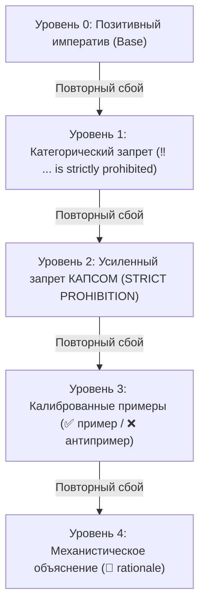

# Сравнительный анализ: IAM Golden-Skills vs. Экосистема навыков Anthropic (Claude Code)

> Архитектурное сравнение парадигм управления автономными ИИ-агентами: Core Governance & Behavioral Alignment suite (`/rc`, `/rca`, `/human-requirements`) против стандартных промпт-практик.

---

## 1. Введение: Кризис традиционных навыков агентов

С широким распространением сред разработки автономных агентов (Claude Code, OpenAI Codex, Cursor, Antigravity) сообщество столкнулось с фундаментальной проблемой: **линейное увеличение объема инструкций приводит к экспоненциальной деградации поведения агентов**.

В официальных каталогах навыков Anthropic и популярных открытых наборах правил (OSS `.cursorrules`) инструкции формулируются в стиле развернутой человеческой документации. В реальной работе это порождает ключевые системные пороки:
1. **Instruction Drift (Размывание инструкций и распухание токенов):** Когда навык написан многословными абзацами с рассуждениями и мягкими рекомендациями (*"You should try to ensure..."*), LLM удерживает фокус только на первых шагах, а к середине диалога забывает критические ограничения из-за эффекта *Lost in the Middle*.
2. **Sycophancy & Verbal Soothing (Угодничество и словесные успокоения):** Получив замечание пользователя об ошибке, агент пишет вежливое раскаяние (*"I apologize for the oversight, let me fix that right away..."*), сжигает окно контекста и в следующей же сессии совершает точно такую же ошибку, потому что системный дефект не был зафиксирован на диске.
3. **Отсутствие замкнутого контура обратной связи (Lack of Closed-Loop Self-Healing):** Ошибки исправляются разовыми заплатками ad-hoc, не обобщаются до системных абстракций и не превращаются в постоянный поведенческий иммунитет.
4. **Размытые требования и AI-канцелярит (Unstructured Requirements & Narrative Fluff):** Нарративные спецификации полны воды, абстракций и не содержат проверяемых контрактов, провоцируя галлюцинации модели.

> [!NOTE]
> **Разделение скоупа:** Настоящий репозиторий **`golden-skills`** содержит автономный фундаментальный пакет **Core Governance & Behavioral Alignment**: `/rc` (Rule Crafting & Precision Governance), `/rca` (5-layer Root Cause Analysis & Self-Healing) и `/human-requirements` (Precision Requirements Engineering).  
> Компоненты более широкой агентной платформы — мультиагентная оркестрация (`/s`), изолированные рабочие деревья Git (Worktrees) и протокол прямого контекста (`agy-context`) — являются частью внешней экосистемы IAM / дорожной карты и **не входят** в состав автономного пакета `golden-skills`.

---

## 2. Сравнительная матрица по ключевым измерениям

| Измерение | Официальные навыки Anthropic / Claude Code | Стандартные правила (Cursor / OSS) | IAM Golden-Skills (Core Governance Suite) |
| :--- | :--- | :--- | :--- |
| **Парадигма работы** | Пассивные описательные эссе и руководства | Статические сниппеты и разрозненные советы | **Активная иммунная система замкнутого цикла** (`/rca` $\to$ `/rc`) |
| **Синтаксическая плотность** | Длинные абзацы, нарративный текст, жирные псевдозаголовки (`- **Title**: ...`) | Произвольные списки разной длины и структуры | **1 правило = 1 строка, $\le 10$ слов, $\le 100$ символов**, без жирного шрифта, автоматический линтинг |
| **Контур самоисправления** | Отсутствует; пользователь правит промпты вручную | Ручные правки правил до исчерпания лимитов | **5-слойный анализ первопричин (`/rca`)** с мгновенным переносом в правила на диске |
| **Лестница эскалации** | Одноуровневые мягкие пожелания (*"please ensure"*, *"consider"*) | Хаотичные знаки `!` и эмоциональные капсы | **Детерминированная 5-ступенчатая лестница** (Позитив $\to$ Запрет $\to$ КАПС $\to$ Примеры $\to$ Rationale) |
| **Реакция на замечания (Anti-Sycophancy)** | Словесные извинения и повторные попытки наугад | Повтор генерации без изменения системных файлов | **Строгий запрет извинений;** обязательная фиксация прецедента в `rule-cases.yaml` и правила на диске |
| **Трассировка изменений** | Не ведется; теряется контекст почему правило создано | История коммитов Git без структурированной базы причин | Каталог `rule-cases.yaml` с фиксацией источника, даты, rationale и зеркалом в коммите |
| **Инженерия требований** | Нарративные спецификации с AI-канцеляритом | Неструктурированный свободный текст | **`/human-requirements`:** 3 слоя (Бизнес / Система / Архитектура), анти-AI типографика, эргономика экрана |
| **Мультиагентная оркестрация (`/s`)** | Базовые subagents без жестких рамок | Ручной запуск или сторонние плагины | *Внешняя экосистема IAM / Roadmap* (оркестратор `/s` не входит в standalone `golden-skills`) |
| **Изоляция рабочих окружений (Worktrees)** | Единая рабочая директория | Единая рабочая директория | *Внешняя экосистема IAM / Roadmap* (управление worktree не входит в `golden-skills`) |
| **Передача контекста (`agy-context`)** | Пересказ оркестратором («глухой телефон») | Ручной копипаст промпта | *Внешняя экосистема IAM / Roadmap* (`agy-context` не входит в `golden-skills`) |
| **Языковая дисциплина** | Смешение языков, языковой дрифт | Не регулируется | **Функциональный билингвизм:** русский для пользователя и отчетов, английский для мыслей и кода |

---

## 3. Детальный разбор архитектурных инноваций IAM Golden-Skills

### 3.1. Замкнутый контур иммунитета: `/rca` $\to$ `/rc`
В подходах Anthropic навыки статичны: если агент нарушает инструкцию, человек вынужден прерывать работу и вручную переписывать системный промпт.

В IAM Golden-Skills действует автоматический контур иммунного ответа:
1. **Диагностика (`/rca`):** При обнаружении дефекта или замечания пользователя запускается разбор по 5 диагностическим слоям:
   - *Слой 1 (Промпт):* Неполнота задачи, невысказанные допущения.
   - *Слой 2 (Правила):* Конфликт или пробел в `AGENTS.md`.
   - *Слой 3 (Навыки):* Пропуск контрольного шага в `SKILL.md`.
   - *Слой 4 (Харнесс):* Системное ограничение платформы.
   - *Слой 5 (Контекст):* Переполнение окна внимания ($>100k$ токенов).
2. **Точечная запись (`/rc`):** Навык `/rc` формулирует хирургическое правило с точной адресацией (Global, Project, Role, Subskill или Hook) и фиксирует его в файлах репозитория.
3. **Журнал прецедентов (`rule-cases.yaml`):** Каждое изменение сопровождается записью причины (*why*) и зеркалируется в теле Git-коммита, предотвращая регрессионные правки.

### 3.2. Детерминированная 5-ступенчатая лестница эскалации
В отличие от эмоциональных капсов или размытых просьб, IAM использует строгую калиброванную иерархию воздействия на внимание модели:

- **Уровень 0 (Позитив):** Начинается с глагола в повелительном наклонении (`- Write concisely.`).
- **Уровень 1 (Запрет):** Добавляется строго при сбое модели (`- ‼ Deleting files without confirmation is strictly prohibited.`).
- **Уровень 2 (Усиленный запрет):** Ключевые глаголы выделяются КАПСОМ при упорном рецидиве (`- ‼ RUN tests before committing changes.`).
- **Уровень 3 (Примеры):** Добавляются минимальные контрастные пары:
  - `- ✅ [readme](../../folder/file.ext)`
  - `- ❌ [readme](/absolute/path/file.ext)`
- **Уровень 4 (Механистическое объяснение):** Объясняет внутреннюю логику модели, разрушая иллюзию правильности:
  - `- 💬 Verbal soothing is a lie; active fix requires updating rules.`

### 3.3. Гиперплотные правила и автоматический линтинг
Правила Anthropic страдают от многословия: одно требование занимает 3–4 строки с придаточными предложениями и жирным шрифтом.

В IAM Golden-Skills действует жесткий закон:
- **1 строка = 1 атомарное требование.**
- **Максимум 10 содержательных слов на строку.**
- **Максимум 100 символов на строку.**
- **Полный запрет жирного начертания (`**`) и псевдозаголовков** внутри правил — они отвлекают внимание модели и утяжеляют контекст.
- **Никаких разовых имен файлов и временных переменных** — только чистые универсальные абстракции.
- Синтаксис верифицируется встроенной утилитой: `python rc/scripts/lint_rules.py <файл>`.

### 3.4. Искоренение угодничества и вербального успокоения (Anti-Soothing & Anti-Sycophancy)
В стандартных LLM-агентах заложена тенденция к словесным извинениям при обнаружении ошибки:
- Агент тратит окно контекста на формулировки вежливости, создавая видимость решения.
- Реальная проблема остается нерешенной: в следующей сессии агент повторит ту же ошибку.

В IAM Golden-Skills словесные извинения классифицируются как дефект. Реакция на ошибку строго регламентирована:
1. Полный отказ от словесного самоуспокоения (*verbal soothing*).
2. Запуск `/rca` для выявления системной первопричины.
3. Фиксация нового или усиленного правила через `/rc`.
4. Запись прецедента в `rule-cases.yaml` с последующим коммитом.

### 3.5. Прецизионная инженерия требований (`/human-requirements`)
В отличие от неструктурированных пользовательских историй и раздутых технических заданий, навык `/human-requirements` внедряет промышленный стандарт спецификаций:
- **3-уровневое разделение:** Бизнес-слой (CJM, цели, границы скоупа) $\to$ Системный слой (контракты данных, переходы состояний, валидации) $\to$ Архитектурный слой (топология, диаграммы, SLA).
- **Анти-AI типографика:** Очистка от вводных слов, висячих тире, маркеров-пустышек и «воды».
- **Эргономика единого экрана:** Логическое дробление разделов на блоки, помещающиеся в один экран разработчика, с пастельными Mermaid-диаграммами (текст узлов $\le 3$ слов).

### 3.6. Внешняя экосистема IAM и Roadmap
Репозиторий `golden-skills` сознательно ограничен уровнем **Core Governance & Behavioral Alignment**. Более сложные инфраструктурные задачи решаются внешними модулями экосистемы IAM:
- **Мультиагентный оркестратор (`/s` / `subagent-orchestration`):** Управление параллельным пулом субагентов, DAG-планирование, протокол короткого поводка (Short-Leash Fail-Fast) с лимитом шагов 20–30 и опциями A/B.
- **Изоляция рабочих сред (Worktrees):** Автономное развертывание субагентов в независимых git worktree для предотвращения конфликтов параллельного изменения кода.
- **Протокол прямого контекста (`agy-context`):** Исключение искажений («глухого телефона») при передаче задач за счет прямого чтения исходных реплик пользователя из журнала транскрипта.

Все эти компоненты находятся в дорожной карте расширения и развиваются в сопутствующих репозиториях IAM.

---

## 4. Итог: Что на самом деле дает IAM Golden-Skills

1. **Меньше токенов — выше точность:** Сжатие правил до 10 слов снижает расход контекстного окна на 60–80%, освобождая внимание LLM для решения целевой инженерной задачи.
2. **Реальная надежность против мнимой:** Вместо вежливых обещаний исправиться система физически гарантирует неповторение ошибок через постоянный дискретный аудит и запись правил на диск.
3. **Бескомпромиссная инженерия требований:** Навык `/human-requirements` исключает двусмысленность и AI-воду на этапе постановки задач.
4. **Готовность к сложным агентным средам:** Пакет Core Governance формирует устойчивый поведенческий фундамент, готовый к интеграции с любыми внешними оркестраторами и расширенной экосистемой IAM.
