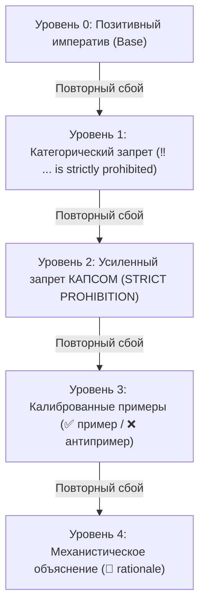

# Сравнительный анализ: IAM Golden-Skills vs. Экосистема навыков Anthropic (Claude Code)

> Архитектурное сравнение парадигм управления автономными ИИ-агентами, защиты контекста и предотвращения поведенческой деградации.

---

## 1. Введение: Кризис традиционных навыков агентов

С выходом агентных сред (Claude Code, OpenAI Codex, Cursor, Antigravity) сообщество столкнулось с фундаментальной проблемой: **увеличение объема инструкций приводит к деградации поведения агентов**.

В официальных репозиториях навыков Anthropic и популярных открытых наборах правил инструкции формулируются в стиле расширенной документации для человека. На практике это порождает три системных порока:
1. **Instruction Drift (Размывание инструкций):** Когда навык написан длинными абзацами с рассуждениями и мягкими рекомендациями (*"You should try to ensure..."*), LLM удерживает фокус только на первых шагах, а к середине диалога забывает ключевые ограничения (эффект *Lost in the Middle*).
2. **Sycophancy & Verbal Soothing (Угодничество и словесные успокоения):** Получив замечание пользователя об ошибке, агент пишет вежливое извинение (*"I apologize for the oversight, let me fix that right away..."*), сжигает окно контекста и в следующей же сессии совершает точно такую же ошибку, потому что системный дефект не был зафиксирован на диске.
3. **Telephone Game (Искажение требований при оркестрации):** Главный агент пересказывает требования пользователя субагентам своими словами, теряя критические детали, допуски и числовые ограничения.

Фреймворк **IAM Golden-Skills** спроектирован как **детерминированная операционная система правил**, устраняющая эти патологии на архитектурном уровне.

---

## 2. Сравнительная матрица по ключевым измерениям

| Измерение | Официальные навыки Anthropic / Claude Code | Стандартные правила (Cursor / OSS) | IAM Golden-Skills |
| :--- | :--- | :--- | :--- |
| **Парадигма работы** | Пассивные описательные эссе и руководства | Статические сниппеты и разрозненные советы | Активная иммунная система замкнутого цикла (`/rca` $\to$ `/rc`) |
| **Синтаксическая плотность** | Длинные абзацы, нарративный текст, жирные псевдозаголовки (`- **Title**: ...`) | Произвольные списки разной длины и структуры | 1 правило = 1 строка, $\le 10$ слов, $\le 100$ символов, без жирного шрифта, автоматический линтинг |
| **Контур самоисправления** | Отсутствует; пользователь правит промпты вручную | Ручные правки в `.cursorrules` до исчерпания лимитов | 5-слойный анализ первопричин (`/rca`) с мгновенным переносом в правила на диске |
| **Лестница эскалации** | Одноуровневые мягкие пожелания (*"please ensure"*, *"consider"*) | Хаотичные знаки `!` и эмоциональные капсы | Детерминированная 5-ступенчатая лестница (Позитив $\to$ Запрет $\to$ КАПС $\to$ Примеры $\to$ Механика) |
| **Реакция на замечания** | Словесные извинения и повторные попытки наугад | Повтор генерации без изменения системных файлов | Строгий запрет на извинения; обязательная хирургическая фиксация правила на диске |
| **Трассировка изменений** | Не ведется; теряется контекст почему правило создано | История коммитов Git без структурированной базы причин | Каталог `rule-cases.yaml` с фиксацией источника, даты, rationale и зеркалом в коммите |
| **Защита контекста субагентов** | Монолитная сессия или передача полного контекста | Переполнение контекста после 3–5 шагов | Лимит $<40k$ токенов на субагента, изоляция сред, отсечение лишних правил по ролям |
| **Передача требований** | Пересказ оркестратором («глухой телефон») | Ручной копипаст промпта | Протокол чистого контекста `agy-context П<N>` — прямое извлечение исходных слов пользователя |
| **Контроль исполнения** | Неограниченное блуждание агента до исчерпания токенов | Агент зависает в циклических ошибках | Протокол короткого поводка (Short-Leash): лимит 20–30 шагов, немедленный стоп и отчет с опциями A/B |
| **Навигация по коду** | Слепой рекурсивный grep и чтение файлов целиком | Неконтролируемый поиск по всей кодовой базе | Хирургическая навигация: запрет слепого грепа, чтение символов срезами $<50$ строк |
| **Верификация изменений** | Визуальный осмотр агентом или запуск по желанию | Нерегулярное тестирование | Обязательный TDD-BDD строгий гейт: падающий тест до правок, код выхода 0, мутационный аудит |
| **Языковая дисциплина** | Смешение языков, языковой дрифт | Не регулируется | Функциональный билингвизм: русский для пользователя и отчетов, английский для мыслей и кода |

---

## 3. Детальный разбор архитектурных инноваций IAM

### 3.1. Замкнутый контур иммунитета: `/rca` $\to$ `/rc`
В подходах Anthropic навыки статичны: если Claude Code нарушает правило, человек вынужден прерывать работу и вручную переписывать системный промпт.

В IAM Golden-Skills действует автоматический контур иммунного ответа:
1. **Диагностика (`/rca`):** При обнаружении дефекта или недовольства пользователя запускается разбор по 5 диагностическим слоям:
   - *Слой 1 (Промпт):* Неполнота задачи, невысказанные допущения.
   - *Слой 2 (Правила):* Конфликт или пробел в `AGENTS.md`.
   - *Слой 3 (Навыки):* Пропуск контрольного шага в `SKILL.md`.
   - *Слой 4 (Харнесс):* Системное ограничение платформы.
   - *Слой 5 (Контекст):* Переполнение окна внимания ($>100k$ токенов).
2. **Точечная запись (`/rc`):** Навык `/rc` формулирует хирургическое правило с точной адресацией (Global, Project, Role, Subskill или Hook) и фиксирует его в файлах репозитория.
3. **Журнал прецедентов (`rule-cases.yaml`):** Каждое изменение сопровождается записью причины (*why*) и зеркалируется в теле Git-коммита, предотвращая регрессионные правки.

### 3.2. Детерминированная лестница эскалации
В отличие от эмоциональных капсов или размытых просьб, IAM использует выверенную иерархию воздействия на внимание модели:

- **Уровень 0 (Позитив):** Начинается с глагола в повелительном наклонении (`- Write concisely.`).
- **Уровень 1 (Запрет):** Добавляется строго при сбое модели (`- ‼ Deleting files without confirmation is strictly prohibited.`).
- **Уровень 2 (Усиленный запрет):** Ключевые глаголы выделяются КАПСОМ при упорном рецидиве (`- ‼ RUN tests before committing changes.`).
- **Уровень 3 (Примеры):** Добавляются минимальные контрастные пары:
  - `- ✅ [readme](../../folder/file.ext)`
  - `- ❌ [readme](/absolute/path/file.ext)`
- **Уровень 4 (Механистическое объяснение):** Объясняет внутреннюю логику модели, разрушая иллюзию правильности:
  - `- 💬 Verbal soothing is a lie; active fix requires updating rules.`

### 3.3. Синтаксическая компрессия и автоматический линтинг
Правила Anthropic страдают от многословия: одно требование занимает 3–4 строки с придаточными предложениями и жирным шрифтом.

В IAM Golden-Skills действует жесткий закон:
- **1 строка = 1 атомарное требование.**
- **Максимум 10 содержательных слов на строку.**
- **Максимум 100 символов на строку.**
- **Полный запрет жирного начертания (`**`) и псевдозаголовков** внутри правил — они отвлекают внимание модели и утяжеляют контекст.
- **Никаких разовых имен файлов и временных переменных** — только чистые универсальные абстракции.
- Синтаксис верифицируется утилитой `lint_rules.py`.

### 3.4. Протокол чистого контекста (`agy-context`)
В мультиагентных системах Anthropic и LangChain оркестратор передает задачу субагенту через пересказ своими словами. Это приводит к потере до 40% критических контекстных нюансов.

В IAM внедрен инструмент `agy-context`:
- Субагент первым действием вызывает `agy-context П<N>`.
- Скрипт поднимает точные, неискаженные формулировки пользователя из логов транскрипта.
- Исключается человеческий фактор и искажения промежуточных агентов.

### 3.5. Протокол короткого поводка (Short-Leash Fail-Fast)
Агенты Claude Code могут часами блуждать по репозиторию, если команда упала с ошибкой или отсутствует нужный файл.

Протокол короткого поводка IAM жестко регламентирует:
- Выделение ограниченного бюджета шагов (обычно 20–30 шагов).
- Немедленная остановка при первом непредвиденном препятствии (отсутствие файла, сбой утилиты, неоднозначность ТЗ).
- Формирование емкого отчета из 2–3 предложений с вариантами решений A/B и передача его вызывающему агенту.
- Жесткий запрет на превышение бюджета шагов без санкции оркестратора.

---

## 4. Итог: Почему IAM Golden-Skills превосходит отраслевые аналоги

1. **Меньше токенов — выше точность:** Сжатие правил до 10 слов снижает расход контекстного окна на 60–80%, освобождая внимание LLM для решения целевой инженерной задачи.
2. **Реальная надежность против мнимой:** Вместо вежливых обещаний исправиться система физически гарантирует неповторение ошибок через постоянный дискретный аудит и запись правил на диск.
3. **Готовность к сложным мультиагентным пайплайнам:** Архитектура готова к масштабированию на команды из десятков параллельных агентов благодаря изоляции контекста, `agy-context` и строгой языковой дисциплине.
