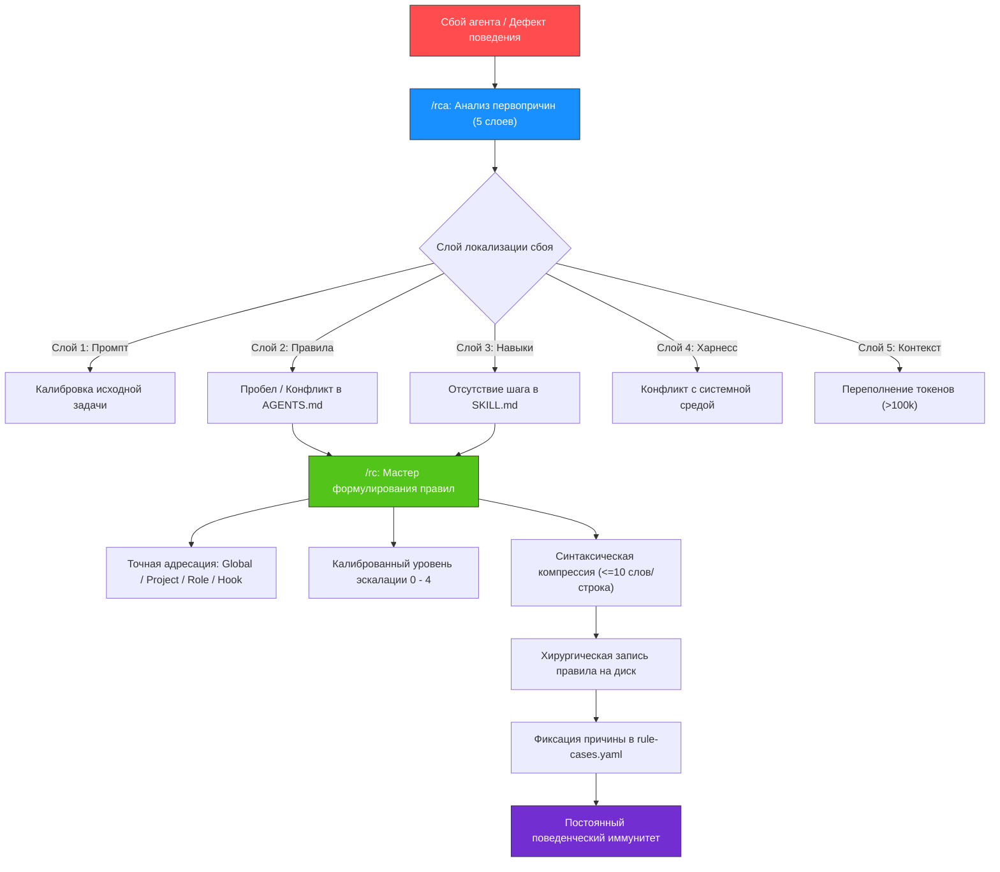

<div align="center">

# 🌟 golden-skills

**Фундаментальный эталонный набор навыков Core Governance & Behavioral Alignment для автономных ИИ-агентов.**  
*Хирургическое управление правилами • Замкнутый контур самоисправления • Прецизионная инженерия требований*

[](LICENSE)
[](CONTRIBUTING.md)
[](#-совместимость-с-платформами-и-установка)
[](https://t.me/prompts4llm)

[Обзор репозитория](README.md) • [Сравнение с навыками Anthropic](COMPARISON_ANTHROPIC.md) • [Руководство по участию](CONTRIBUTING.md)

</div>

---

## 💡 Зачем создан golden-skills?

**`golden-skills`** — это эталонный автономный набор **Core Governance & Behavioral Alignment** для разработчиков ИИ-агентов, который **рассматривает поведенческие баги агента строго как баги в коде** (*Agent operating system treating behavioral bugs as code bugs*).

Репозиторий содержит фундаментальный триумвират навыков выравнивания поведения:
- **[`/rc`](rc/SKILL.md) — Rule Crafting & Precision Governance:** Синтез, оптимизация и компрессия правил с линтингом и детерминированной лестницей эскалации.
- **[`/rca`](rca/SKILL.md) — 5-layer Root Cause Analysis & Self-Healing:** Анализ первопричин сбоев по 5 слоям без пустых извинений с прямой передачей ТЗ на диск.
- **[`/human-requirements`](human-requirements/SKILL.md) — Precision Requirements Engineering:** Проектирование требований, спецификаций и критериев приемки без синтетической «воды» и AI-канцелярита.

Подавляющее большинство сбоев автономных ИИ-агентов вызваны **не** слабостью базовых моделей (Claude 3.5 Sonnet, Gemini 2.0 Flash/Pro, GPT-4o), а **кризисом архитектуры инструкций и обратной связи**:

1. **Размывание инструкций и распухание токенов (Instruction Drift & Token Bloat):** Традиционные агентные среды перегружаются длинными нарративными эссе. Модель страдает от эффекта *Lost in the Middle* и теряет ключевые ограничения уже через несколько шагов.
2. **Угодничество и словесные успокоения (Sycophancy & Verbal Soothing):** Получив замечание, агент генерирует вежливые извинения (*«Извините за ошибку, сейчас исправлю...»*), сжигая окно контекста, но в следующей же сессии совершает тот же сбой, поскольку патч не зафиксирован на диске.
3. **Отсутствие замкнутого контура обратной связи (Lack of Closed-Loop Self-Healing):** Сбои исправляются ситуативно, не обобщаются до системных абстракций и не закрепляются в неизменяемых правилах.
4. **Загрязнение контекста чужими правилами (Audience Pollution):** Инструкции узких ролей попадают в глобальный промпт и засоряют память всех остальных агентов.
5. **Неструктурированные и водянистые требования (Unstructured Requirements & AI Fluff):** Размытые формулировки и нарративная «вода» провоцируют галлюцинации и ложные допущения модели при реализации задач.

---

## 🔄 Архитектура замкнутого контура (Closed-Loop Immune System)

В основе репозитория лежит концепция **поведенческого иммунитета**: любая ошибка агента становится катализатором автоматического системного исправления.



1. **Диагностика через `/rca`:** Выявление истинной первопричины сбоя по 5 слоям без пустых извинений.
2. **Исправление через `/rc`:** Синтез предельно сжатых атомарных директив с автоматическим линтингом и немедленной фиксацией на диске.

---

## 🚀 Ключевые архитектурные инновации

### 1. Детерминированная лестница эскалации (Escalation Ladder)
Вместо размытых рекомендаций или эмоционального капса используется строгая последовательность калибровки воздействия на модель:

| Уровень | Тип правила | Синтаксис и поведение | Пример |
| :---: | :--- | :--- | :--- |
| **0** | **Позитивный императив** | Базовое правило, глагол повелительного наклонения | `- Пиши лаконично.` |
| **1** | **Категорический запрет** | Добавляется строго при сбое модели на уровне 0 | `- ‼ Удаление файлов без подтверждения строго запрещено.` |
| **2** | **Усиленный запрет КАПСОМ** | Усиление ключевых глаголов при упорных рецидивах | `- ‼ ЗАПУСКАЙ тесты перед фиксацией изменений.` |
| **3** | **Калиброванные примеры** | Минимальная контрастная пара (1 строка на пример) | `- ✅ [readme](../../folder/file.ext)`<br>`- ❌ [readme](/absolute/path/file.ext)` |
| **4** | **Механистическое объяснение** | Разрушает иллюзию правильности модели (`💬`) | `- 💬 Словесное успокоение — ложь; исправление требует правки правил.` |

### 2. Синтаксическая компрессия и автоматический линтинг
- **1 правило = 1 строка.** Объединение двух требований в одну строку запрещено.
- **Лимит:** не более 10 содержательных слов и не более 100 символов на строку.
- **Полный запрет жирного начертания (`**`) и псевдозаголовков** внутри правил — они рассеивают внимание и тратят токены.
- **Никаких эпизодических переменных и временных путей** — только универсальные абстракции.
- Соответствие стандартам проверяется встроенным линтером: `python rc/scripts/lint_rules.py <файл>`.

### 3. Искоренение угодничества и вербального успокоения (Anti-Soothing & Anti-Sycophancy)
- Полный запрет словесных извинений (*«I apologize...»*, *«Простите за оплошность...»*) при замечаниях пользователя или падении тестов.
- Любой сбой классифицируется как дефект правил и требует обязательного вызова `/rca` с последующей фиксацией правила на диске через `/rc`.
- Фиксация прецедентов в реестре `rule-cases.yaml` с обязательной привязкой rationale к сообщению коммита.

### 4. Прецизионная инженерия требований (`/human-requirements`)
- Строгое 3-уровневое разделение: Бизнес-слой (CJM, цели) $\to$ Системный слой (контракты данных, граничные случаи) $\to$ Архитектурный слой (диаграммы, SLA).
- Анти-AI типографика: беспощадное удаление вводных слов, висячих тире, маркеров-пустышек и синтетической «воды».
- Эргономика единого экрана: визуальные схемы по стандарту [diagrams.md](human-requirements/references/diagrams.md) (текст узлов $\le 3$ слов) и 6-стадийный пайплайн компрессии [transformation.md](human-requirements/references/transformation.md).

### 5. Функциональный билингвизм
- Публичные документы, отчеты и диалог с пользователем ведутся исключительно на русском языке.
- Внутренние мысли (`thought`), комментарии в коде, правила и меж-агентные сообщения — исключительно на английском языке для максимальной точности следования логике LLM.

### 6. Границы скоупа: golden-skills vs. Внешняя экосистема IAM
Репозиторий `golden-skills` содержит строго автономный фундамент **Core Governance & Behavioral Alignment**. Компоненты продвинутого мультиагентного исполнения:
- **Мультиагентный оркестратор (`/s` / `subagent-orchestration`):** координация пула параллельных субагентов, DAG-планирование и протокол короткого поводка (Short-Leash Fail-Fast);
- **Изоляция рабочих пространств (Worktree Management):** автоматическое создание изолированных git-worktree для предотвращения конфликтов параллельных сессий;
- **Протокол прямого контекста (`agy-context`):** защита от искажения требований («глухого телефона») через извлечение сырых реплик пользователя из логов;
— входят в расширенную внешнюю экосистему IAM (`iam-skills`) и дорожную карту развития, но **не входят** в состав данного репозитория.

---

## 📊 Сравнение: IAM Golden-Skills vs. Навыки Anthropic

Подробный аналитический разбор доступен в документе [COMPARISON_ANTHROPIC.md](./COMPARISON_ANTHROPIC.md).

| Критерий | Навыки Anthropic (Claude Code) | Стандартные правила Cursor / OSS | IAM Golden-Skills (Core Governance Suite) |
| :--- | :--- | :--- | :--- |
| **Формат правил** | Длинные текстовые эссе, нарратив | Произвольные списки разной структуры | 1 строка $\le 10$ слов, строгий линтинг `lint_rules.py` |
| **Контур обратной связи** | Ручной; пользователь правит промпты сам | Отсутствует; правила растут бесконтрольно | **Замкнутый контур:** 5-слойный `/rca` $\to$ запись через `/rc` |
| **Реакция на замечания** | Словесные извинения («I apologize...») | Повторная генерация без фиксации на диске | **Запрет угодничества:** фиксация прецедента в `rule-cases.yaml` и правила на диске |
| **Эскалация требований** | Мягкие пожелания (*"please ensure"*) | Случайные восклицательные знаки | **5 детерминированных ступеней эскалации** (0 — 4) |
| **Трассировка изменений** | Не поддерживается | Обычные коммиты без фиксации причин | Журнал `rule-cases.yaml` + why-сообщения коммитов |
| **Инженерия требований** | Нарративные описания с AI-канцеляритом | Неструктурированный текст | **`/human-requirements`:** 3 слоя, анти-AI типографика, эргономика экрана |
| **Мультиагентная оркестрация (`/s`)** | Базовые subagents без жестких рамок | Ручной запуск или сторонние плагины | *Внешняя экосистема IAM / Roadmap* (оркестратор `/s` не входит в golden-skills) |
| **Изоляция рабочих окружений (Worktrees)** | Единая рабочая директория | Единая рабочая директория | *Внешняя экосистема IAM / Roadmap* (управление worktree не входит в golden-skills) |
| **Передача контекста (`agy-context`)** | Пересказ своими словами («глухой телефон») | Ручной копипаст промпта | *Внешняя экосистема IAM / Roadmap* (`agy-context` не входит в golden-skills) |

---

## 📦 Каталог эталонных навыков

### 1. [`/rc`](rc/SKILL.md) — Rule Crafting & Precision Governance (Мастер формулирования правил)
📁 **Путь:** `rc/` • **Описание:** *"Применяй когда нужно создать, изменить или оптимизировать правило, инструкцию AGENTS.md или навык"*

Ликвидирует словесный мусор и обеспечивает максимальную плотность сигнала: $\text{Эффективность} = \frac{\text{Сигнал}}{\text{Шум}}$.

- **Проектирование адресата:**
  - *Global `AGENTS.md`:* Правила, действующие в $\ge 80\%$ всех задач.
  - *Project `AGENTS.md`:* Правила, действующие в $\ge 80\%$ задач конкретного проекта.
  - *Role Skill (`SKILL.md`):* Правила, действующие в $\ge 70\%$ задач конкретной роли.
  - *Subskill (`references/`):* Выделяется при накоплении $\ge 6$ правил для специфической ситуации.
  - *Linter / Hook:* Механические проверки форматов и синтаксиса.
  - *Discard:* Разовые прихоти или ошибки кода (не сохраняются в правилах).
- **Вспомогательные руководства:**
  - [skill-authoring.md](rc/references/skill-authoring.md) — стандарты создания новых навыков.
  - [subskill-authoring.md](rc/references/subskill-authoring.md) — модульная декомпозиция поднавыков.
  - [skill-extraction.md](rc/references/skill-extraction.md) — протокол извлечения знаний в навык.
  - [skill-refactoring.md](rc/references/skill-refactoring.md) — очистка устаревших правил.
  - [utility-setup.md](rc/references/utility-setup.md) — интеграция утилит и линтеров.

---

### 2. [`/rca`](rca/SKILL.md) — 5-layer Root Cause Analysis & Self-Healing (Анализ первопричин сбоев)
📁 **Путь:** `rca/` • **Описание:** *"Применяй когда обнаружено нарушение правила или шаг агента был неоптимален"*

Структурированный диагностический фреймворк, отсекающий ложное раскаяние агента:

- **5 слоев локализации:**
  1. *Промпт:* Отсутствие границ, невысказанные предположения.
  2. *Правила:* Конфликты формулировок, пробелы в `AGENTS.md`.
  3. *Навыки:* Пропущенные верификационные гейты в `SKILL.md`.
  4. *Харнесс:* Конфликты с системной средой платформы.
  5. *Контекст:* Переполнение контекста ($>100k$ токенов), потеря внимания.
- **Принцип обобщения:** Единичные эпизоды обобщаются до системных паттернов — временные пути и имена файлов в правила никогда не попадают.
- **Бесшовная передача:** Финал диагностики формирует готовое ТЗ для немедленного исполнения навыком `/rc`.

---

### 3. [`/human-requirements`](human-requirements/SKILL.md) — Precision Requirements Engineering (Инженерия требований)
📁 **Путь:** `human-requirements/` • **Описание:** *"Применяй когда нужно составить спецификацию, пользовательскую историю или критерии приемки"*

Проектирует сверхплотные, легко читаемые спецификации без синтетической «воды» и корпоративного канцелярита:

- **Анти-AI типографика:** Полное удаление псевдозаголовков, курсивов, висячих тире и вводных слов.
- **3-уровневое разделение:**
  - *Бизнес-слой:* Цели, черный ящик, CJM глазами пользователя, явные границы скоупа.
  - *Системный слой:* Контракты данных, переходы состояний, валидации, граничные случаи.
  - *Архитектурный слой:* Топология компонентов, диаграммы взаимодействия, SLA.
- **Эргономика единого экрана:** Дробление разделов по размеру экрана для исключения когнитивной перегрузки.
- **Визуальные протоколы:**
  - [diagrams.md](human-requirements/references/diagrams.md) — пастельные схемы, текст узлов $\le 3$ слов, согласованные стрелки.
  - [transformation.md](human-requirements/references/transformation.md) — 6-стадийный пайплайн сжатия без потери численных требований.

---

## 🛠️ Совместимость с платформами и установка

Навыки соответствуют открытому стандарту Agent Skill (`SKILL.md` с заголовком YAML frontmatter) и работают во всех современных средах:

| Платформа | Расположение навыков | Статус |
| :--- | :--- | :---: |
| **Google Antigravity** | `~/.gemini/config/skills/` или `<project>/.agents/skills/` | ✅ Нативно |
| **Claude Code** | `~/.claude/skills/` или `<project>/.claude/skills/` | ✅ Нативно |
| **Cursor** | `.cursor/rules/` или проектные навыки | ✅ Совместимо |
| **OpenAI Codex / CLI** | `.codex/skills/` или системная конфигурация | ✅ Совместимо |
| **Hermes Agent** | `~/.hermes/skills/` | ✅ Совместимо |

### Быстрая установка

```bash
# Клонирование репозитория
git clone https://github.com/SpIvanM/golden-skills.git

# Установка для Google Antigravity
cp -r golden-skills/rc ~/.gemini/config/skills/
cp -r golden-skills/rca ~/.gemini/config/skills/
cp -r golden-skills/human-requirements ~/.gemini/config/skills/

# Установка для Claude Code
cp -r golden-skills/rc ~/.claude/skills/
cp -r golden-skills/rca ~/.claude/skills/
cp -r golden-skills/human-requirements ~/.claude/skills/
```

Или создание символических ссылок в рабочем проекте:
```bash
ln -s /path/to/golden-skills/rc .agents/skills/rc
ln -s /path/to/golden-skills/rca .agents/skills/rca
ln -s /path/to/golden-skills/human-requirements .agents/skills/human-requirements
```

---

## 📂 Структура репозитория

```text
golden-skills/
├── LICENSE                       # Лицензия MIT
├── README.md                     # Основная документация репозитория (на русском языке)
├── README_RU.md                  # Зеркало документации
├── COMPARISON_ANTHROPIC.md       # Аналитическое сравнение с экосистемой Anthropic
├── CONTRIBUTING.md               # Руководство по контрибуции
├── rc/                           # Навык создания и оптимизации правил (/rc)
│   ├── SKILL.md                  # Спецификация на английском языке
│   ├── SKILL_RU.md               # Спецификация на русском языке
│   ├── rule-cases.yaml           # Реестр прецедентов и причин изменений
│   ├── scripts/lint_rules.py     # Автоматический линтер правил
│   └── references/               # Руководства по созданию поднавыков
│       ├── skill-authoring.md
│       ├── subskill-authoring.md
│       ├── skill-extraction.md
│       ├── skill-refactoring.md
│       └── utility-setup.md
├── rca/                          # Навык анализа первопричин (/rca)
│   ├── SKILL.md                  # Спецификация на английском языке
│   └── SKILL_RU.md               # Спецификация на русском языке
└── human-requirements/           # Навык проектирования требований (/human-requirements)
    ├── SKILL.md                  # Спецификация на английском языке
    ├── SKILL_RU.md               # Спецификация на русском языке
    └── references/               # Протоколы диаграмм и трансформации
        ├── diagrams.md
        └── transformation.md
```

---

## 👤 Автор и сообщество

- **Автор:** Иван Моисеев ([@SpIvanM](https://github.com/SpIvanM)) — Senior Product Manager и архитектор мультиагентных систем.
- **Telegram-канал:** [t.me/prompts4llm](https://t.me/prompts4llm) — промпт-инжиниринг, агентные архитектуры и передовые практики LLM.

---

## 📄 Лицензия

Распространяется под лицензией **MIT**. Подробности в файле [`LICENSE`](LICENSE).
