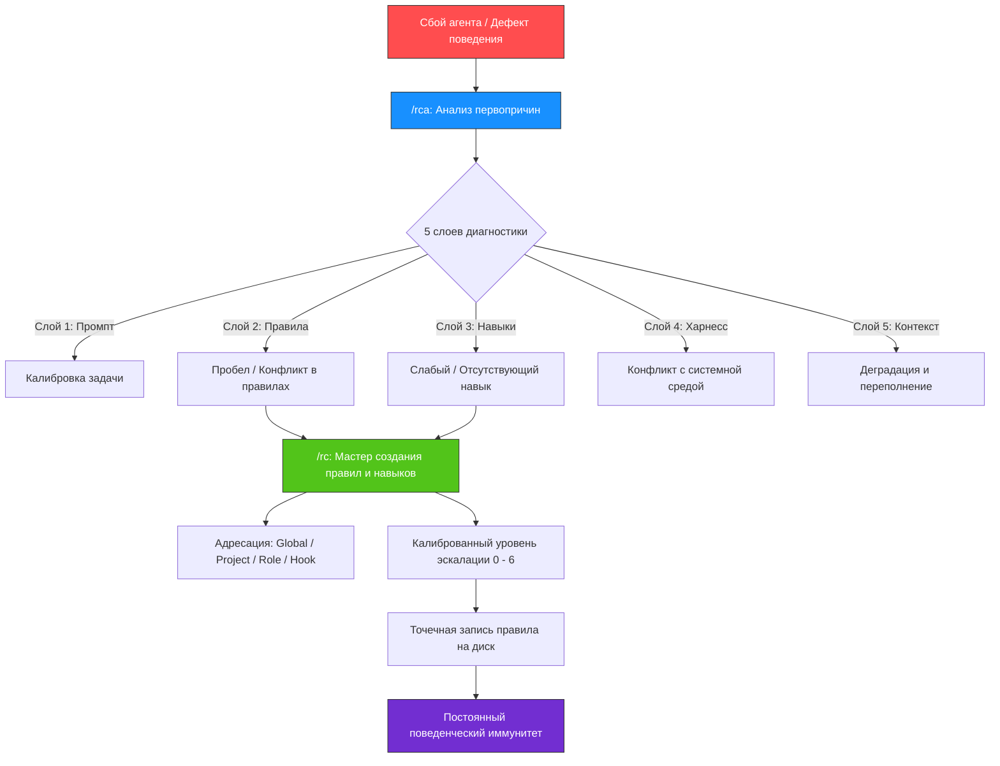

<div align="center">

# 🌟 golden-skills

**Базовый набор проверенных навыков для автономных ИИ-агентов разработчика.**  
*Максимальный рычаг • Защита контекста от мусора • Четкие уровни эскалации • Замкнутый контур самоисправления*

[](LICENSE)
[](CONTRIBUTING.md)
[](#-совместимость-с-платформами)
[](https://t.me/prompts4llm)

[English](README.md) • [Русский](README_RU.md)

</div>

---

## 💡 Зачем нужен golden-skills?

Большинство сбоев в работе ИИ-агентов вызваны **не** ограничениями моделей, а **ошибками архитектуры инструкций и обратной связи**:
- **Размывание инструкций и распухание контекста:** По мере роста инструкций LLM теряет фокус, если правила написаны длинно, витиевато и без приоритетов.
- **Угодничество и словесные успокоения:** Получив замечание, агент извиняется («Извините за ошибку, сейчас всё исправлю»), но через шаг повторяет тот же сбой, поскольку дефект не устранен на диске.
- **Неправильная адресация:** Правила, нужные только узкому субагенту, зашиваются в глобальный промпт и засоряют память всех остальных агентов.

**`golden-skills`** — это операционный фреймворк, внедряющий культуру **Agent-First**: самодиагностика дефектов поведения через 5 почему и хирургическое закрепление правил минимальной длины с максимальной сигнальной плотностью.

---

## 🔄 Архитектура замкнутого цикла (Closed Loop)

Репозиторий объединяет две ключевые взаимодополняющие компетенции:



1. **Диагностика через `/rca`:** Изоляция слоя сбоя по методу 5 почему с отсечением сикофантии (угодничества).
2. **Устранение через `/rc`:** Синтез атомарных директив высокой плотности с назначением точного адресата и минимального уровня эскалации.

---

## 📦 Входящие в состав навыки

### 1. `/rc` — Rule & Skill Crafting (Мастер правил и навыков)
📁 **Путь:** `rc/` • **Описание:** *"Применяй когда нужно изменить или написать правило, навык"*

Ликвидирует словесный мусор в системных инструкциях. Построен на принципах KISS и YAGNI.

#### Проектирование адресата (Чье это правило?)
| Адресат | Где размещается | Назначение |
| :--- | :--- | :--- |
| **Global** | Корень хранилища / глобальный `AGENTS.md` | Универсальные инварианты, обязательные для всех агентов. |
| **Project** | `<project-root>/AGENTS.md` | Специфика стека, архитектура и структура конкретного репозитория. |
| **Scoped** | `.agents/rules/*.md` | Ограничения для группы файлов по маске (globs). |
| **Role** | Управляющий `SKILL.md` роли | Компетенции конкретного амплуа агента (оркестратор, исполнитель). |
| **Hook / Linter** | Git-хуки или скрипты | Детерминированные механические проверки форматирования и линтинга. |
| **Мусор** | *Нигде (не превращать в правила)* | Разовые прихоти или частные эпизоды. |

#### Шкала уровней эскалации
Новые правила всегда стартуют с **Level 0**. Эскалация допустима строго при зафиксированных повторных нарушениях:

| Уровень | Обозначение | Суть и грамматика | Пример |
| :---: | :---: | :--- | :--- |
| **0** | Базовый | Прямой безусловный глагол в повелительном наклонении | `- Пиши кратко.` |
| **1** | `!` | Контрастный императив или условие выбора | `- Передавай все сообщения: избыток лучше пропуска.` |
| **2** | `!!` | Категорический запрет (`строго запрещено` / `запрещен`) | `- ‼ Запуск субагента без номеров сообщений строго запрещен.` |
| **3** | `!!!` | КАПС в операционных глаголах при рецидивах | `- ‼ ЗАПУСКАЙ тесты перед коммитом изменений.` |
| **4** | `!!!!` | Короткий позитивный пример (1 строка) | `- !!!! ✅ [readme](../../folder/file.ext)` |
| **5** | `!!!!!` | Короткий антипаттерн / негативный пример (1 строка) | `- !!!!! ❌ [readme](file:///path/file.ext)` |
| **6** | `💬` | Механистическое краткое объяснение (1 строка) | `- 💬 Словесные успокоения ложны; исправление требует правки правил.` |

#### Сравнение формулировок: как надо и как не надо

| ❌ Плохо (Слабо, двусмысленно, раздуто) | ✅ Отлично (Атомарно, действенно, плотно) |
| :--- | :--- |
| `- **Пути**: Всегда используйте относительные пути, а также обязательно спрашивайте подтверждение перед rm.` | `- Используй относительные пути для ссылок в воркспейсе.`<br>`- ‼ Удаление файлов без подтверждения пользователя строго запрещено.` |
| `- Запрет слепого запуска: запуск без номеров сообщений запрещен.` | `- ‼ Запуск субагента без номеров сообщений строго запрещен.` |
| `- Пожалуйста, старайся писать тесты всегда, когда есть возможность.` | `- Пиши падающие тесты до изменения рабочего кода.` |

---

### 2. `/rca` — Targeted Root Cause Analysis (Прицельный анализ первопричин)
📁 **Путь:** `rca/` • **Описание:** *"Применяй когда нужно найти первопричину дефекта по 5 why, rca или /rca"*

Инструмент дисциплинированного расследования поведенческих ошибок ИИ-агентов.

#### 5 диагностических слоев
1. **Слой 1 (Промпт):** Неполнота задачи, неявные допущения пользователя, отсутствие границ.
2. **Слой 2 (Правила):** Пробелы в `AGENTS.md`, конфликтующие директивы, вредные косвенные стимулы.
3. **Слой 3 (Навыки):** Двусмысленности в `SKILL.md`, пропущенные этапы валидации.
4. **Слой 4 (Харнесс):** Системные директивы платформы (system prompt), конфликтующие с целью.
5. **Слой 5 (Контекст):** Переполнение контекста (>100k токенов), деградация внимания и инструктивный дрейф.

#### Фундаментальные принципы RCA
- **Табу на словесные извинения:** Фразы вида «простите, я был неправ» запрещены. Единственный признаваемый результат работы — обнаружение и фиксация причины дефекта в конфигурации на диске.
- **Учет внутренних привычек модели:** Учет присущих LLM привычек (угодничество, поспешность, ложная уверенность).
- **Принцип вместо частностей:** Запрещено вносить в правила временные имена файлов или разовые детали; выделяется универсальный поведенческий шаблон.
- **Бесшовный переход к `/rc`:** Завершение сессии конкретной задачей в формате `/rc` с указанием файла, уровня и текста директивы.

---

### 3. `/human-requirements` — Инженерия человечных требований
📁 **Путь:** `human-requirements/` • **Описание:** *"Применяй когда нужно написать инженерные требования, спецификацию продукта, системную user story или критерии приемки"*

Создает лаконичные инженерные требования с максимальной плотностью смысла, устраняя синтетическое многословие ИИ и корпоративный булшит. Воплощает роль ведущего системного аналитика с глубоким пониманием архитектуры.

#### Ключевые принципы
- **Анти-слоп типографика:** Полный отказ от полужирных псевдозаголовков в списках (`- **Название**: ...`), типографских кавычек-елочек и длинных тире. Опора на четкие заголовки Markdown и прямые активные глаголы.
- **Послойная спецификация (Progressive Disclosure):**
  - *Слой 1 (Бизнес):* Стратегические цели, система как «черный ящик», путь пользователя (CJM) без деталей реализации, явные границы скоупа.
  - *Слой 2 (Система):* Контракты данных, переходы состояний, логика валидации и краевые сценарии.
  - *Слой 3 (Архитектура):* Топология сервисов, асинхронные sequence-диаграммы, протоколы взаимодействия и нефункциональные SLA.
- **Эргономика единого экрана:** Дробление требований на компактные логические блоки, укладывающиеся в один экран, что исключает усталость внимания и потерю контекста.
- **Протокол визуальных диаграмм ([`references/diagrams_ru.md`](human-requirements/references/diagrams_ru.md)):** Пастельная палитра без рамок (эффект стикеров), компактный текст узлов (<3 слов), принудительные переносы строк, строгое соответствие цвета стрелок линиям.
- **Пошаговый протокол трансформации ([`references/transformation_ru.md`](human-requirements/references/transformation_ru.md)):** 6-этапный конвейер атомарных проходов (Инвентарь каркаса -> Обзорный CJM -> Очистка от реализации -> Механическая гигиена -> Семантическое сжатие -> Гейт сверки без потерь), предотвращающий галлюцинации и потерю числовых параметров.

---

## 🛠️ Совместимость с платформами

Все навыки репозитория оформлены по открытому стандарту Agent Skills (`SKILL.md` + YAML frontmatter) и нативно работают во всех современных агентных средах:

| Платформа | Расположение навыков | Статус |
| :--- | :--- | :---: |
| **Google Antigravity** | `~/.gemini/config/skills/` или `<проект>/.agents/skills/` | ✅ Нативно |
| **Claude Code** | `~/.claude/skills/` или `<проект>/.claude/skills/` | ✅ Нативно |
| **Cursor** | `.cursor/rules/` или проектные навыки | ✅ Совместимо |
| **OpenAI Codex / CLI** | `.codex/skills/` или проектные конфиги | ✅ Совместимо |
| **Hermes Agent** | `~/.hermes/skills/` | ✅ Совместимо |

### Быстрая установка

```bash
# Клонирование репозитория
git clone https://github.com/SpIvanM/golden-skills.git

# Установка глобально для Google Antigravity
cp -r golden-skills/rc ~/.gemini/config/skills/
cp -r golden-skills/rca ~/.gemini/config/skills/
cp -r golden-skills/human-requirements ~/.gemini/config/skills/

# Установка глобально для Claude Code
cp -r golden-skills/rc ~/.claude/skills/
cp -r golden-skills/rca ~/.claude/skills/
cp -r golden-skills/human-requirements ~/.claude/skills/
```

Или создайте символические ссылки прямо в рабочем проекте:
```bash
ln -s /path/to/golden-skills/rc .agents/skills/rc
ln -s /path/to/golden-skills/rca .agents/skills/rca
ln -s /path/to/golden-skills/human-requirements .agents/skills/human-requirements
```

---

## 📂 Структура репозитория

```text
golden-skills/
├── LICENSE                       # Лицензия MIT
├── README.md                     # Документация на английском языке
├── README_RU.md                  # Документация на русском языке
├── CONTRIBUTING.md               # Руководство по внесению вклада
├── rc/                           # Навык создания правил и навыков
│   ├── SKILL.md                  # Спецификация (EN)
│   ├── SKILL_RU.md               # Спецификация (RU)
│   └── references/               # Референсы и шаблоны
│       ├── skill-authoring.md
│       └── skill-authoring_RU.md
├── rca/                          # Навык анализа первопричин
│   ├── SKILL.md                  # Спецификация (EN)
│   └── SKILL_RU.md               # Русская спецификация
└── human-requirements/           # Навык инженерии требований
    ├── SKILL.md                  # Спецификация (EN)
    ├── SKILL_RU.md               # Русская спецификация
    └── references/               # Протоколы диаграмм и трансформации
        ├── diagrams.md
        ├── diagrams_ru.md
        ├── transformation.md
        └── transformation_ru.md
```

---

## 🤝 Участие в разработке (Contributing)

Мы приветствуем вклад сообщества! Если у вас есть предложения по улучшению формулировок, новые уровни эскалации или идеи для добавления новых фундаментальных навыков, ознакомьтесь с [CONTRIBUTING.md](CONTRIBUTING.md).

---

## 👤 Автор и сообщество

- **Автор:** Иван Моисеев ([@SpIvanM](https://github.com/SpIvanM)) — Senior Product Manager и архитектор ИИ-агентов.
- **Telegram-канал:** [t.me/prompts4llm](https://t.me/prompts4llm) — Промпт-инжиниринг, агентные архитектуры и передовые практики работы с LLM.

---

## 📄 Лицензия

Распространяется под лицензией **MIT**. Подробности в файле [`LICENSE`](LICENSE).
