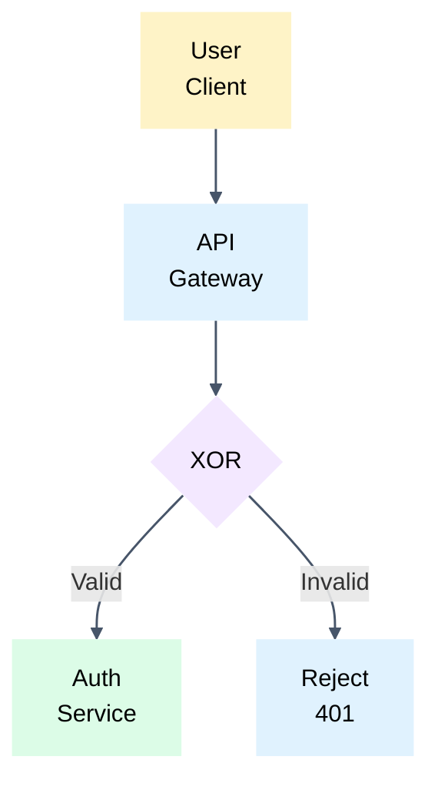
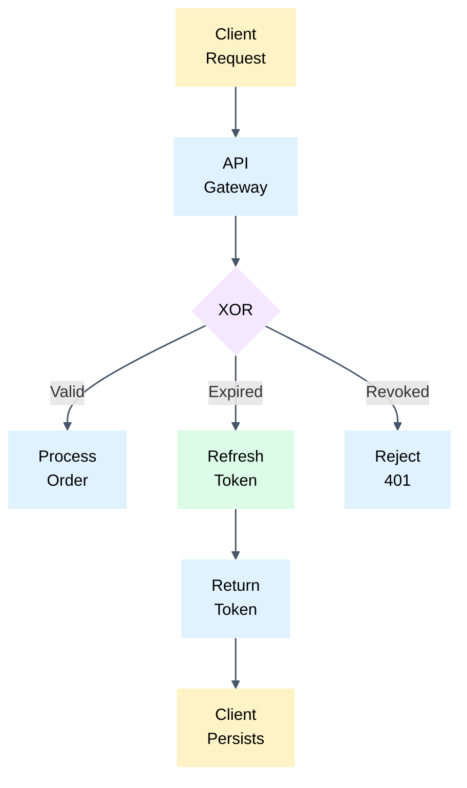
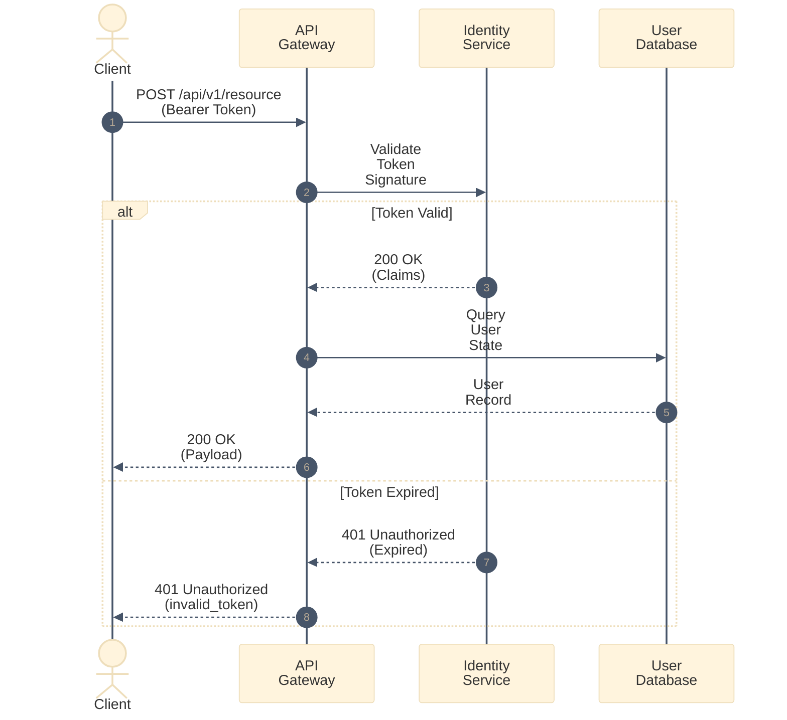

# Diagramming & Visual Specifications

Guide for authoring technical diagrams in software requirements.

## When to Diagram
- Authoring workflow: draft textual requirements first, then visualize connectivity with a diagram before the text.
- Illustrate complex non-linear workflows, multi-party interactions, and branching algorithms.
- Skip diagrams for trivial, linear, or single-step operations.
- Place interaction diagrams directly before corresponding detailed textual requirements.
- Keep textual specifications self-contained; transcribing diagram flows into prose is prohibited.
- Treat diagrams as the primary behavioral source only when text is too cumbersome.

## Flowcharts & Orientation (flowchart TD / LR)
- Orientation selection algorithm: mentally visualize the diagram in LR and TD, then choose the variant with the smaller horizontal footprint.
- Avoid wide horizontal structures because screen compression degrades readability.
- Keep text inside nodes ultra-brief at 1-3 words.
- ‼ Wrap every word longer than 3 letters onto a new line using  : strict invariant for nodes, arrows, and all labels.
- ‼ Placing long questions inside decision diamonds is prohibited; label diamond `{XOR}`, `{OR}`, cross `{x}`, `{+}`, or DFD/BPMN notation.
- Annotate decision branch conditions directly on outgoing connecting arrows.

## Sequence Diagrams (sequenceDiagram)
- Use `sequenceDiagram` for distributed, multi-service, or asynchronous interactions.
- Order participants logically from caller to backend services.
- Keep message descriptions concise and focused on protocol actions or status codes.
- Ensure arrows and arrowheads match line color via `%%{init: {'theme': 'base', 'themeVariables': { 'signalColor': '#475569', 'lineColor': '#475569', 'actorLineColor': '#475569' }}}%%`.
- Wrapping exception: keep conditions in sequence diagram branching headers (alt, else, opt, loop) on one line without ` `.

## Pastel Visual Palette & ClassDef
- Group semantically related elements with identical pastel fill tones.
- Use light, non-intrusive pastel fills (like sticky notes) strictly without visible borders (`stroke-width:0px`, `stroke:none`) and with black text (`color:#000`).
Preserve subtle grey frames around flowchart edge label boxes (sequence diagram message labels render natively without frames across line breaks).
Ensure arrowheads strictly match line color (`#475569` or `#333333`):
- Flowchart: via `linkStyle default stroke:#475569,stroke-width:1.5px,fill:none`.
- Sequence diagrams: via `init` block with `signalColor: '#475569', lineColor: '#475569'`.

### Color Reference
| Class | Fill | Stroke | Semantic Role |
| :--- | :--- | :--- | :--- |
| `actor` | `#fef3c7` | `none (stroke-width:0px)` | Client application, end user, interactive agent |
| `system` | `#e0f2fe` | `none (stroke-width:0px)` | Internal service, gateway, processor, state machine |
| `decision` | `#f3e8ff` | `none (stroke-width:0px)` | Branching logic, routing fork, condition check |
| `external` | `#dcfce7` | `none (stroke-width:0px)` | External service, third-party provider, auth provider |

## Examples

### 1. Vertical Decision Flowchart

### 2. Multi-Service Sequence Diagram

