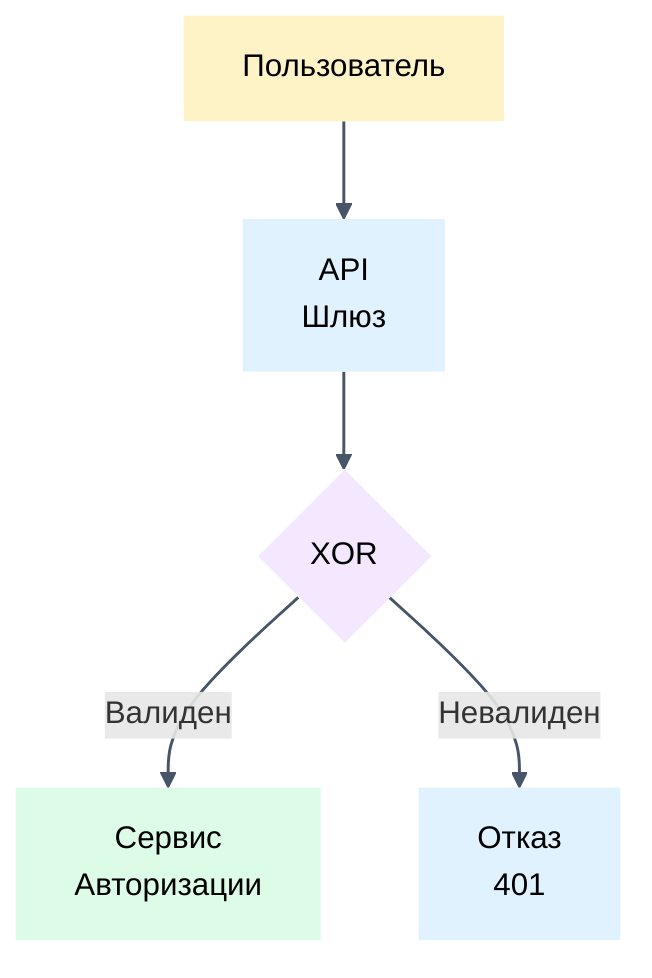
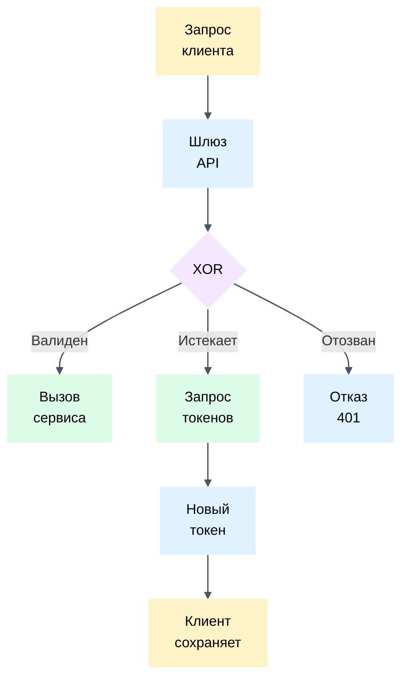
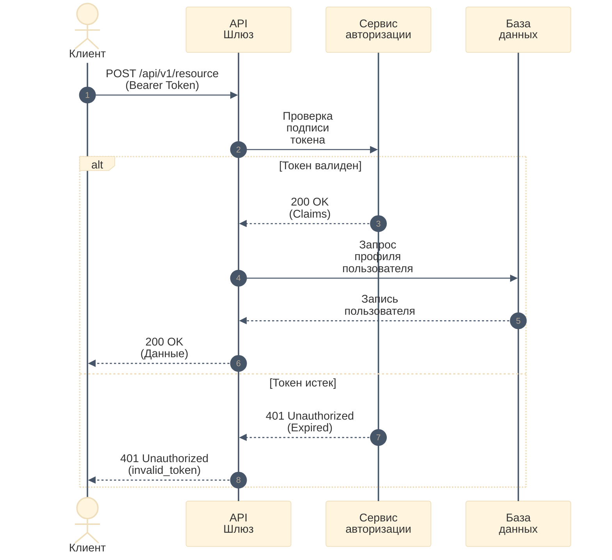

# Оформление диаграмм и визуализация

Руководство по созданию диаграмм при составлении инженерных требований.

## Когда создавать диаграммы
- Авторский процесс: сначала сформулируй требования текстом, затем визуализируй связи схемой перед текстом.
- Описывай сложные нелинейные сценарии, переходы состояний и межсервисные вызовы.
- Не создавай диаграммы для простых, линейных или одношаговых операций.
- Размещай диаграмму связей непосредственно перед детальными текстовыми требованиями.
- Сохраняй самодостаточность текста без диаграммы; пересказ диаграммы в тексте запрещен.
- Используй диаграмму как первичный источник только если поведение слишком громоздко для текста.

## Блок-схемы и ориентация (flowchart TD / LR)
- Алгоритм выбора ориентации: мысленно представь диаграмму при LR и при TD и выбери вариант, при котором меньший размер по горизонтали.
- Избегай широких горизонтальных конструкций, так как при просмотре они сжимаются по ширине экрана и становятся нечитаемыми.
- Ограничивай надписи внутри блоков до 1-3 слов.
- ‼ Переноси через   на новую строку каждое слово длиннее 3 букв: строгое правило для блоков, стрелок и любых подписей.
- ‼ Размещать длинные вопросы внутри ромбов ветвления запрещено; помечай ромб `{XOR}`, `{OR}`, крестиком `{x}`, `{+}` или в нотации DFD/BPMN.
- Выноси пояснения условий ветвления на подписи к исходящим стрелкам.

## Диаграммы последовательности (sequenceDiagram)
- Используй `sequenceDiagram` для описания распределенных межсервисных или асинхронных вызовов.
- Располагай участников логически от вызывающего клиента к внутренним сервисам.
- Делай подписи сообщений краткими, фиксируя операции протоколов или коды состояния.
- Задавай нейтральный цвет стрелок и наконечников в цвет линий через блок `%%{init: {'theme': 'base', 'themeVariables': { 'signalColor': '#475569', 'lineColor': '#475569', 'actorLineColor': '#475569' }}}%%`.
- Исключение из переноса: в заголовках ветвлений (alt, else, opt, loop) пиши условия в одну строку без ` `.

## Пастельная палитра и ClassDef
- Выделяй близкие по смыслу или относящиеся к одному контуру элементы схемы одним пастельным цветом.
- Используй светлые неяркие пастельные тона (как клейкие стикеры) для блоков строго без рамок (`stroke-width:0px`, `stroke:none`) и с черным текстом (`color:#000`).
У стрелок блок-схем (flowchart) сохраняй тонкие серые рамки плашек подписей (в sequenceDiagram подписи нативно идут без рамок с разрывом линии).
Наконечники стрелок делай строго одного цвета с линией (`#475569` или `#333333`):
- Для `flowchart`: через `linkStyle default stroke:#475569,stroke-width:1.5px,fill:none`.
- Для `sequenceDiagram`: через `init`-блок с `signalColor: '#475569', lineColor: '#475569'`.

### Таблица классов и цветов
| Класс | Цвет заливки | Рамка | Семантическая роль |
| :--- | :--- | :--- | :--- |
| `actor` | `#fef3c7` | `none (stroke-width:0px)` | Клиентское приложение, пользователь, внешний агент |
| `system` | `#e0f2fe` | `none (stroke-width:0px)` | Внутренний сервис, шлюз, обработчик, автомат состояний |
| `decision` | `#f3e8ff` | `none (stroke-width:0px)` | Развилка логики, маршрутизация, проверка условия |
| `external` | `#dcfce7` | `none (stroke-width:0px)` | Внешний сервис, сторонний провайдер, сервис аутентификации |

## Примеры

### 1. Вертикальная блок-схема с развилками

### 2. Распределенная диаграмма последовательности

