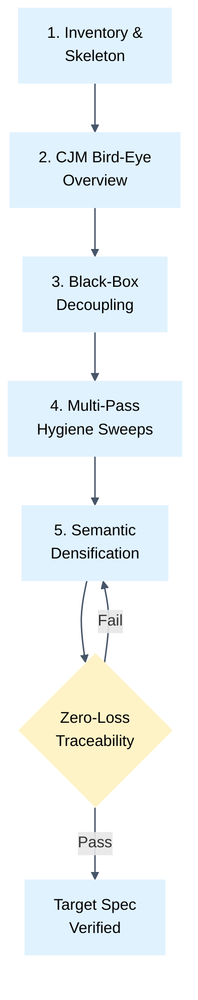

# Incremental Requirements Transformation Protocol

Guide for refactoring unstructured, verbose, or synthetic AI draft requirements into concise, high-signal engineering specifications.

## 1. The Anti-Hallucination Law

- Single-pass rewriting of draft requirements is strictly prohibited.
- Large generative rewrites cause models to hallucinate generic abstractions, drop edge cases, lose numerical SLAs, and dilute domain terminology.
- Transformation must proceed through a sequence of atomic, single-focus micro-passes on disk.
- Each micro-pass addresses exactly one structural or syntactic concern across the document.

## 2. Six-Stage Transformation Pipeline

---

### Stage 1: Inventory & Structural Skeleton (Zero-Loss Baseline)
- Construct the target table skeleton: Title, Behavioral Scenario, and DoD checklist.
- Transfer every existing requirement from the raw draft into table rows verbatim.
- Preserve all numbers, timeouts, limits, SLAs, and technical codes verbatim.
- Prohibit semantic rewriting, summarization, or trimming during this initial stage.

### Stage 2: High-Level Journey Decoupling
- Condense the Customer Journey Map (CJM) into a high-level bird-eye overview.
- Restrict CJM columns to: Stage, User Action, Touchpoint / System Reaction, and Outcome.
- Purge detailed operational edge cases and duplicate DoD items from the journey table.
- Omit sequential digit numbers in journey stage names; use clean descriptive titles.

### Stage 3: Architecture & Ownership Decoupling
- Strip all provider, contractor, vendor, and internal platform ownership terms from business requirements.
- Formulate requirements strictly from the perspective of an outside observer treating the system as a black box.
- Segregate requirements into standard priority sections: Mandatory, Recommended, Optional, and Under Discussion.

### Stage 4: Multi-Pass Mechanical Sweeps (Single-Focus Hygiene)
Execute dedicated, separate passes across the entire document without combining tasks:

#### Sweep 4.1: Parentheses & Foreign Duplicates (3 Consecutive Sweeps)
- Pass 1: Eliminate all foreign term duplicates in parentheses: `native (foreign)` ➡ `native`.
- Pass 2: Eliminate all explanatory parenthetical remarks in criteria; rephrase with commas or separate clauses.
- Pass 3: Run automated regex verification `rg "\([^\)]*\)"`.
- Acceptable parentheses: markdown links `[text](url)` strictly.
- If non-link parentheses remain, repeat removal sweep until the regex match count is strictly 0.

#### Sweep 4.2: Inline Bold & Emphasis Purge
- Execute a dedicated sweep removing all inline `**bold**` styling inside table cells and list items.
- Retain markdown section headings (`#`, `##`, `###`) as the sole visual anchors.

#### Sweep 4.3: Typography Normalization
- Replace curly quotes `“ ” « »` with standard straight ASCII quotes `"`.
- Replace em-dashes `—` and en-dashes `–` with standard keyboard hyphens `-`.
- Format multi-item criteria in table cells with ` ` line break delimiters.

### Stage 5: Semantic Densification & De-duplication
- Shorten user story titles to concise noun phrases under four words.
- Eliminate bureaucratic filler, passive participle constructions, and synthetic AI preambles.
- Merge overlapping or fragmented criteria across adjacent stories into consolidated entries.
- Segregate contentious, unconfirmed, or experimental requirements into `### Under Discussion`.

### Stage 6: Traceability Gate & Final Verification
- Audit every scenario and edge case from the initial draft against the final table.
- Confirm zero loss of business conditions, error thresholds, or numeric bounds.
- Validate automated hygiene gates: zero non-link parentheses, zero inline bolding in table cells, zero sequential row numbers.
