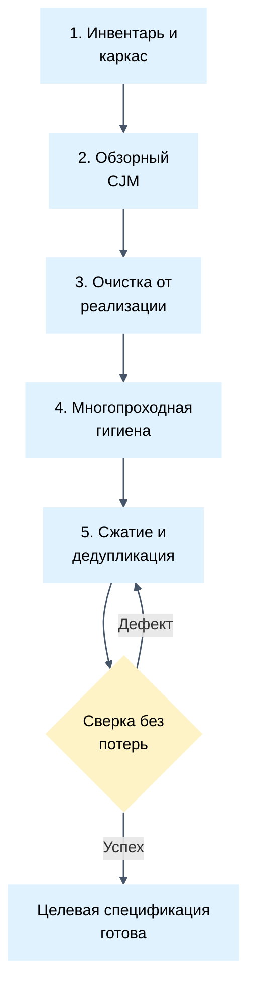

# Регламент пошаговой трансформации черновика требований

Практическое руководство по переработке неструктурированных, водянистых или синтетических черновиков требований в лаконичные, высокосигнальные инженерные спецификации.

## 1. Закон защиты от галлюцинаций и абстракций

- Переписывание сырых требований единым широким генеративным проходом строго запрещено.
- Однопроходный рерайт приводит к потере сути: модель выдумывает размытые абстракции, теряет граничные условия, числовые SLA и вымывает предметные термины.
- Трансформация выполняется строго цепочкой изолированных атомарных правок на диске.
- Каждый микро-этап решает ровно одну структурную или синтаксическую задачу во всем документе.

## 2. Шестиэтапный пайплайн трансформации

---

### Этап 1: Инвентаризация и каркас (барьер нулевых потерь)
- Сформируй каркас целевой таблицы: Название истории, Сценарий / Описание поведения, Критерии приемки (DoD).
- Перенеси все требования из сырого черновика в строки таблицы дословно.
- Сохраняй все числа, тайм-ауты, лимиты, SLA и технические коды без изменений.
- Запрещено сокращать, перефразировать или удалять пункты на этом шаге.

### Этап 2: Обзорная карта пути клиента (CJM)
- Сокращай карту пути клиента (CJM) до верхнеуровневого обзорного вида.
- Ограничивай структуру CJM колонками: Этап пути, Действие пользователя, Точка контакта и реакция сервиса, Результат этапа.
- Исключай детальные операционные граничные кейсы и дублирование критериев DoD из таблицы CJM.
- Убирай порядковую нумерацию цифрами из названий этапов; используй чистые смысловые названия.

### Этап 3: Очистка от деталей реализации (черный ящик)
- Удаляй указания подрядчиков, провайдеров, маркетплейсов и компонентов платформы из бизнес-требований.
- Описывай поведение строго с позиции внешнего наблюдателя: что видит пользователь, что передается и возвращается.
- Разделяй требования по стандартным секциям приоритетов: Обязательно, Желательно, Возможно и На обсуждении.

### Этап 4: Многопроходная механическая гигиена (изолированные проходы)
Выполняй отдельные, изолированные проходы по всему документу, не смешивая задачи:

#### Проход 4.1: Очистка терминов в скобках (3 последовательных прохода)
- Проход 1: Устраняй английские термины-дубли в скобках: `термин (term)` ➡ `термин`.
- Проход 2: Устраняй пояснительные замечания в скобках внутри критериев и сценариев; переформулируй через запятые или отдельные предложения.
- Проход 3: Проверочный проход. Запусти сканирование регулярным выражением: `rg "\([^\)]*\)"`.
- Допустимы строго ссылки Markdown вида `[текст](url)`.
- Если найдены скобки вне ссылок, повторяй проход очистки до достижения строго 0 совпадений.

#### Проход 4.2: Удаление жирного начертания
- Выполняй отдельный проход по удалению `**жирного шрифта**` внутри ячеек таблиц и списков.
- Заголовки Markdown (`#`, `##`, `###`) остаются единственными визуальными якорями.

#### Проход 4.3: Нормализация типографики
- Заменяй кавычки «елочки» и “лапки” на стандартные прямые ASCII-кавычки `"`.
- Заменяй длинные тире `—` и короткие тире `–` на стандартный дефис `-`.
- Оформляй многострочные списки внутри ячеек таблиц разделителем ` `.

### Этап 5: Сжатие формулировок и дедупликация
- Сокращай названия пользовательских историй до кратких именных фраз до четырех слов.
- Устраняй канцелярит, пассивные причастные конструкции и вводные формулировки ИИ («Данное требование необходимо...»).
- Объединяй дублирующиеся критерии разрозненных историй в единые формулировки.
- Выноси спорные, экспериментальные или несогласованные требования в раздел `### На обсуждении`.

### Этап 6: Гейт проверки покрытия и финальная сверка
- Сверь каждый сценарий и граничный случай исходного черновика с полученной таблицей.
- Убедись, что ни одно бизнес-правило, порог ошибки или числовой лимит не потеряны.
- Проверь автоматические гейты: 0 круглых скобок вне ссылок, 0 жирного шрифта в ячейках, 0 порядковых номеров строк.
