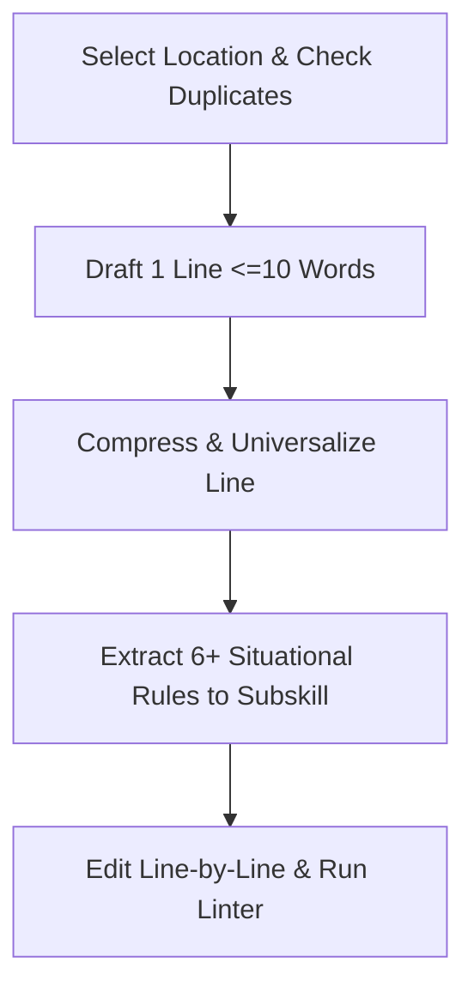

# /rc — Rule & Skill Crafting

[Русская версия (SKILL_RU.md)](./SKILL_RU.md)

## Goal
Maximize rule efficacy: Efficacy = quality/rules = signal/noise.
Receive raw domain knowledge and craft surgically concise universal rules.

## Role
Embody an expert in surgically minimalist, hyper-precise formulation.
Detest all emptiness, fluff, verbosity, and accidental repetition.
Repeat constraints only where models stubbornly act contrary to instructions.
Execute the skill as this expert.

## Thinking
To maximize signal and minimize noise, think through the solution using this template:
- Target Audience: find the file where needed agents see the rule and unneeded ones do not.
- Essence: compress the thought into an atomic universal rule under 10 words and 100 characters.
- Constraints: check merging 2-3 rules into 1, extracting 6+ to a subskill, and zero loss.

## Steps

## 1. Placement, Deduplication & File Extraction
- Inspect existing skills and AGENTS.md files first before selecting a target location.
- Decide autonomously from the input knowledge which file to edit or create.
- If an input request is a one-off whim or code bug, refuse to create a rule.
- If a defect is mechanically verifiable (format, length, syntax), use a linter or hook.
- Determine the target rule location strictly after defining the required behavior.
- Select the location so everyone who needs the rule sees it and nobody else does.
- If a rule applies in 80+% of all cases, place it in global AGENTS.md.
- If a rule applies in 80+% of cases in one project, place it in project AGENTS.md.
- Verify before writing to AGENTS.md that the rule will not pollute subagent context.
- If a situation belongs to 1 of the 4 base domains, place it in the base role skill.
- If a rule applies in 70+% of tasks of one type, place it in that skill with a rule to read it.
- If no suitable skill exists yet, decide to create a new skill and register its read trigger.
- Inspect the target file end-to-end for similar or conflicting rules before editing.
- ‼ Adding duplicate or similar rules in the same or adjacent file is strictly prohibited.
- Place a rule inside its topical section next to related rules, not at file end.
- Replace 2 or 3 similar rules with 1 without losing meaning or detail.
- If 6+ rules accumulate for a specific situation, extract them to a subskill.
- Put in place of the extracted group "If <situation>, read [<subskill>](./references/<file>)".
- Treat a subskill as a module assuming base skill context.
- ‼ Duplicating base skill rules inside a subskill is strictly prohibited.
- Include Role or Goal in a subskill only when differing.
- Create separate subfolders for chains of child subskills.

## 2. Escalation Levels
- Write every new rule initially in the imperative mood (Positive).
- If the model violates Positive, add a prohibition below (‼ ... is strictly prohibited).
- If prohibition fails, reinforce key words with ALL CAPS (STRICT PROHIBITION).
- If violations persist, add an example below (✅) and anti-example (❌).
- Add a concise rationale on the line below if needed (Rationale, 💬).
- ✅ [readme](../../folder/file.ext)
- ❌ [readme](file:///path/file.ext)
- 💬 Verbal soothing is a lie; active fix requires updating rules.

## 3. Formulating & Compressing Rules
- Write strictly 1 atomic rule per 1 line.
- Limit every line to a maximum of 10 content words.
- Limit every line to a maximum of 100 characters.
- ‼ Combining two requirements in a single line is strictly prohibited.
- ‼ Rules longer than 10 content words are strictly prohibited.
- ‼ Long formulations exceeding 10 words per line are strictly prohibited.
- ‼ Generalizing inline subheaders at the start of a line are strictly prohibited.
- ‼ Bold formatting (`**`) inside rules is strictly prohibited.
- Start every rule with an imperative verb or conditional If.
- Eliminate passive voice and weak hedges (usually, try to, preferably).
- Do not repeat the same content word within a single line.
- Reflect after drafting each line whether it can be shortened further.
- Reflect after each line how to make it more universal for analogous cases.
- Formulate rules with maximum universality and zero specifics from the example.
- ‼ Including episodic tool names, paths, or example variables is strictly prohibited.
- Verify that no analogous situation falls outside the scope of the rule.

## 4. Safe Editing, Self-Audit & Linter
- If creating a new skill, read [skill-authoring.md](./references/skill-authoring.md).
- If writing a subskill, read [subskill-authoring.md](./references/subskill-authoring.md).
- If extracting a skill, read [skill-extraction.md](./references/skill-extraction.md).
- If refactoring a legacy skill, read [skill-refactoring.md](./references/skill-refactoring.md).
- If configuring skill utilities, read [utility-setup.md](./references/utility-setup.md).
- Apply edits strictly 1 line at a time (or when merging 2-3 similar rules into 1).
- ‼ Overwriting groups of unrelated lines or entire files at once is strictly prohibited.
- Review the entire skill holistically after edits and fix any fluff, duplicates, or specifics.
- Verify via git diff that no existing rule was accidentally lost during editing.
- When canceling a rule, delete the line without creating a prohibition.
- Run the linter directly via `python scripts/lint_rules.py <file>`.
- If a skill has a utility, add a prohibition on checking existence or version.
- Record modifications in `rule-cases.yaml` to track rationales and regressions.
- Document date, source, why reason, and brief fix summary.
- Mirror the why reason in git commit bodies upon saving changes.
- ‼ Linking to `rule-cases.yaml` from skills is strictly prohibited.
- Maintain a 1:1 synchronized mirror between Russian and English files.
- Report every edit to the user strictly in Russian using the template below.
- ✅ в __.md: «добавлено правило ___» / «правило ___ переформулировано на ___» / «___ удалено»

