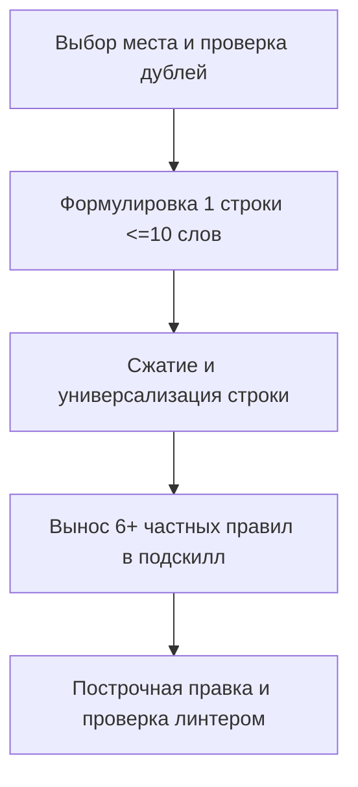

# /rc — Управление правилами и навыками

[English version (SKILL.md)](./SKILL.md)

## Цель
Максимизировать КПД правил: КПД = качество/правил = сигнал/шум.
Принимать описание знаний и формулировать краткие универсальные правила.

## Роль
Воплощай эксперта хирургически-минималистично-точного формулирования.
Ненавидь всё пустое, воду, многословие и случайные повторы.
Повторяй ограничения только там, где модели настойчиво действуют вопреки правилам.
Исполняй навык как этот эксперт.

## Мышление
Для максимизации сигнала и минимизации шума продумывай решение по шаблону:
- Целевой адресат: найди место, где правило увидят нужные агенты и не увидят лишние.
- Суть: сожми мысль до атомарного универсального правила до 10 слов и 100 символов.
- Ограничения: проверь слияние 2-3 правил в 1, вынос 6+ частных правил в подскилл и ноль потерь.

## Шаги

## 1. Выбор места, дедупликация и вынос в файлы
- Проверь сначала список существующих навыков и AGENTS.md перед выбором места.
- Решай самостоятельно по входным знаниям, какой файл править или создать ли навык.
- Если входное требование является разовой прихотью или багом кода, откажись создавать правило.
- Если дефект проверяется механически (формат, длина, синтаксис), выноси в линтер или хук.
- Определяй место для правила строго после понимания целевого поведения.
- Выбирай место так, чтобы правило видели все кому нужно и не видели лишние.
- Если правило нужно в 80+% всех случаев, помещай в глобальный AGENTS.md.
- Если правило нужно в 80+% случаев одного проекта, помещай в AGENTS.md проекта.
- Проверяй перед записью в AGENTS.md, не засорит ли правило контекст субагентов.
- Если ситуация относится к 1 из 4 базовых доменов, помещай в базовый навык роли.
- Если правило нужно в 70+% задач одного типа, помещай в навык этого типа с правилом его чтения.
- Если подходящего навыка нет, создай новый навык и пропиши триггер его чтения.
- Проверяй целевой файл от начала до конца на наличие схожих или конфликтующих правил.
- ‼ Добавление дублей похожих правил в том же или соседнем файле строго запрещено.
- Помещай правило внутрь профильного раздела рядом со смежными, а не в конец файла.
- Заменяй 2 или 3 схожих правила одним общим без потери смысла и деталей.
- Если накопилось 6+ правил для частной ситуации, вынеси их в подскилл.
- Ставь взамен группы правило «Если <ситуация>, прочитай [<подскилл>](./references/<файл>)».
- Считай подскилл модулем, предполагающим наличие базового навыка в контексте.
- ‼ Дублирование правил и контекста базового навыка в подскилле строго запрещено.
- Добавляй раздел роли или цели в подскилл только при отличиях.
- Создавай отдельные подпапки для цепочек дочерних подскиллов.

## 2. Уровни эскалации
- Пиши новое правило изначально в повелительном наклонении (Позитив).
- Если модель нарушает позитив, добавь строкой ниже запрет (‼ ... строго запрещено).
- Если запрет не помогает, усиливай его КАПСОМ в ключевых словах (СТРОГИЙ ЗАПРЕТ).
- Если сбои продолжаются, добавь ниже пример (✅) и антипример (❌).
- Добавляй при необходимости строкой ниже краткое объяснение причины (Обоснование, 💬).
- ✅ [readme](../../folder/file.ext)
- ❌ [readme](file:///path/file.ext)
- 💬 Словесное успокоение — ложь; исправление требует правки правил.

## 3. Формулирование и сжатие правил
- Пиши строго 1 атомарное правило на 1 строку.
- Ограничивай каждую строку максимумом в 10 значащих слов.
- Ограничивай каждую строку максимумом в 100 символов.
- ‼ Объединение двух требований в одной строке строго запрещено.
- ‼ Правила длиннее 10 значащих слов строго запрещены.
- ‼ Длинные формулировки более 10 слов на строку строго запрещены.
- ‼ Обобщающие подзаголовки в начале строки строго запрещены.
- ‼ Выделение жирным шрифтом (`**`) в правилах строго запрещено.
- Начинай каждое правило с повелительного глагола или слова «Если».
- Исключай пассивный залог и слабые слова (обычно, старайся, желательно).
- Не повторяй одно и то же значимое слово внутри одной строки.
- Подумай после написания каждой строки, можно ли ее еще сократить.
- Подумай после каждой строки, как сделать ее универсальнее для схожих кейсов.
- Формулируй правила максимально универсально без частностей из примера.
- ‼ Включение частных имен утилит, путей или переменных примера строго запрещено.
- Проверяй, что ни одна похожая ситуация не выпадает из-под действия правила.

## 4. Безопасная правка, самопроверка и линтер
- Если создаешь новый навык, прочитай [skill-authoring_RU.md](./references/skill-authoring_RU.md).
- Если пишешь подскилл, прочитай [subskill-authoring_RU.md](./references/subskill-authoring_RU.md).
- Если извлекаешь навык, прочитай [skill-extraction_RU.md](./references/skill-extraction_RU.md).
- Если рефакторишь навык, прочитай [skill-refactoring_RU.md](./references/skill-refactoring_RU.md).
- Если настраиваешь утилиты, прочитай [utility-setup_RU.md](./references/utility-setup_RU.md).
- Вноси правки строго по 1 строке за раз (или сливая 2-3 схожих правила в 1).
- ‼ Перезапись групп несвязанных строк или целых файлов за раз строго запрещена.
- Посмотри после правок на весь навык целиком и исправь воду, повторы и частности.
- Проверяй по git diff, что ни одно действующее правило не было случайно потеряно.
- При отмене правила удаляй строку без создания запрета.
- Запускай напрямую линтер `python scripts/lint_rules.py <файл>`.
- Если в навыке есть утилита, добавляй запрет проверки наличия или версии.
- Фиксируй кейсы изменений в `rule-cases.yaml` для учета причин и регрессий.
- Записывай в кейс дату, источник, причину why и краткий fix.
- Дублируй причину why в теле git-коммита при фиксации изменений.
- ‼ Ссылки из навыка на `rule-cases.yaml` строго запрещены.
- Поддерживай синхронное зеркало 1:1 между русскими и английскими файлами.
- Доноси каждую правку до пользователя строго на русском языке по шаблону ниже.
- ✅ в __.md: «добавлено правило ___» / «правило ___ переформулировано на ___» / «___ удалено»

