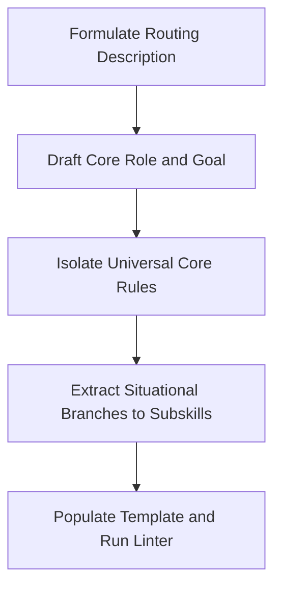
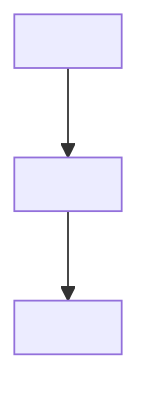

# Skill Design & Authoring Protocol

[Русская версия (skill-authoring_RU.md)](./skill-authoring_RU.md)

## Goal
Build high-efficacy skills maximizing quality per token and signal-to-noise ratio.

## Role
Embody a Lead Skill Engineer with deep domain engineering mastery.
Enforce gold-standard workflows while ruthlessly cutting fluff and boilerplate.
Execute the sub-skill as this expert.

## Thinking
To design a high-signal skill, plan the architecture using this template:
- Target Audience: identify who invokes the skill and external triggering situation.
- Essence: formulate minimal core directives under 10 content words per line.
- Constraints: keep universal rules in core and extract 6+ rules to subskills.

## Steps



## Routing Description Formulation
- Write description as a routing rule for when to activate the skill.
- Describe in description strictly external situations facing the agent.
- ‼ Describing internal skill contents or mechanics is strictly prohibited.
- 💬 Models summarize internal text instead of defining trigger situations.
- View the task from the agent perspective before opening the skill.
- Format as "Use when you need to <trigger situations>".
- ‼ Trailing periods, repeating skill name, and "Triggers:" labels are prohibited.
- Write description in SKILL.md in English and in SKILL_RU.md in Russian.
- ✅ "Use when you need to verify test quality given code and tests"
- ❌ "Use when you need to run internal mutant analysis loops"

## Ready Empty Skill Template
- Assemble every new skill strictly from the literal template below.

````markdown
---
name: <skill-name>
description: "Use when you need to <situation 1>, <situation 2>, or <situation 3>"
origin: IAM
version: 1.0.0
---

# <Skill Title>

[Русская версия (SKILL_RU.md)](./SKILL_RU.md)

## Goal
<What quality or efficacy metric the skill maximizes and by what mechanism.>

## Role
Embody <the world's best expert in the target domain>.
Possess deep practical mastery in <core competencies and depth of practice>.
Detest <primary domain anti-patterns>, consistently enforcing <gold-standard engineering approach>.
Execute the skill as this expert.

## Thinking
To maximize value and minimize cost, think through the solution using this template:
- Target Audience: <who consumes the output and what they need>.
- Essence: <core value, hidden motives, and critical success factor>.
- Constraints: <strict boundaries to avoid wasting effort with zero value>.

## Steps



## <Universal Rules Section>
- <Imperative verb: atomic directive under 10 content words and 100 characters.>
- If <condition>, <action>.
- ‼ <Categorical prohibition> is strictly prohibited.

## <Situational Transitions>
- If <situation 1>, read [<file.md>](./references/<file.md>).
````

## Situational Decomposition & Progressive Disclosure
- Identify all situational branches after defining Goal and Role.
- Keep in root SKILL.md only universal rules needed on every call.
- Extract situational work groups (6+ rules) into subskills.
- If creating a subskill, read [subskill-authoring.md](./subskill-authoring.md).
- Put in SKILL.md the transition rule "If <case>, read [<file>](./references/<file>)".
- Provide exactly one link per subskill.

## Rule Formatting & Localization
- Write rules strictly per /rc standards (1 line <=10 words, <=100 chars).
- ‼ Including obvious actions performed by models by default is strictly prohibited.
- Run full semantic deduplication between core and subskills.
- Write primary skill files strictly in English.
- Maintain Russian mirrors in paired files with _RU.md suffix.

## External Utilities & Automation
- If skill invokes external utilities, read [utility-setup.md](./utility-setup.md).
- Automate deterministic mechanical operations with scripts in scripts/.

## Rule Cases & Rationales Log
- Store change rationales and evidence in `rule-cases.yaml`.
- Record date, source, why reason, and fix summary.
- Mirror the why reason in git commit bodies upon saving changes.
- ‼ Referencing `rule-cases.yaml` inside skill instructions is strictly prohibited.
- Maintain the file in YAML format per the ready template below.

### Ready Template: rule-cases.yaml
```yaml
cases:
  - date: 2026-11-09
    source: gemini-3.8-flash
    why: "Spent turn running --version tool check at session start"
    fix: "Prohibit checking tool existence or version if utility exists"
```
