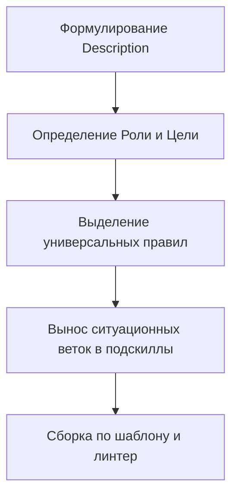
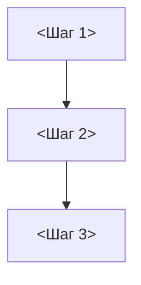

# Протокол проектирования и создания навыков

[English version (skill-authoring.md)](./skill-authoring.md)

## Цель
Создавать высокоэффективные навыки с максимальным КПД и соотношением сигнал/шум.

## Роль
Воплощай ведущего инженера с глубоким опытом в предметной области.
Опирайся на эталонные практики области, отсекая воду и банальности.
Исполняй поднавык как этот эксперт.

## Мышление
Для проектирования емкого навыка спланируй архитектуру по шаблону:
- Целевой адресат: определи, кто вызывает навык и внешнюю ситуацию вызова.
- Суть: сформулируй базовые правила до 10 значащих слов на строку.
- Ограничения: оставь в ядре универсальные правила, а 6+ выноси в подскиллы.

## Шаги



## Формулирование Description (Триггер активации)
- Пиши description как правило, указывающее модели ситуации вызова навыка.
- Описывай в description строго внешние ситуации агента.
- ‼ Описывать в description внутреннее содержимое или методы строго запрещено.
- 💬 Модели пересказывают текст навыка вместо ситуаций его вызова.
- Смотри на задачу глазами агента до открытия навыка.
- Формулируй по схеме «Применяй когда нужно <перечисление ситуаций>».
- ‼ Точка на конце, повтор имени навыка и метки «Триггеры:» запрещены.
- Пиши description в SKILL.md на английском, а в SKILL_RU.md — на русском.
- ✅ "Применяй когда нужно проверить качество тестов при наличии кода"
- ❌ "Применяй когда нужно выполнить запуск внутренних мутаций кода"

## Готовый пустой шаблон навыка
- Собирай каждый новый навык строго по готовому буквальному шаблону ниже.

````markdown
---
name: <skill-name>
description: "Применяй когда нужно <внешняя ситуация 1>, <ситуация 2> или <ситуация 3>"
origin: IAM
version: 1.0.0
---

# <Название навыка>

[English version (SKILL.md)](./SKILL.md)

## Цель
<Какую метрику качества или КПД максимизирует навык и за счет чего.>

## Роль
Воплощай <лучшего в мире эксперта в предметной области навыка>.
Обладай глубоким практическим опытом в <ключевые компетенции и глубина практики>.
Презирай <главные анти-паттерны области>, неизменно обеспечивая <эталонный инженерный подход>.
Исполняй навык как этот эксперт.

## Мышление
Для максимизации ценности и минимизации затрат продумай решение по этому шаблону:
- Целевой адресат: <для кого создается результат и кто его потребитель>.
- Суть: <главная ценность, скрытые мотивы и ключевой фактор успеха>.
- Ограничения: <жесткие рамки, чтобы не тратить усилия с нулевой ценностью>.

## Шаги



## <Раздел универсальных правил>
- <Повелительный глагол: атомарное правило до 10 значащих слов и 100 символов.>
- Если <условие>, <действие>.
- ‼ <Категорический запрет> строго запрещено.

## <Ситуационные переходы>
- Если <ситуация 1>, прочитай [<файл_RU.md>](./references/<файл_RU.md>).
````

## Ситуационная декомпозиция и подскиллы
- Продумай после цели и роли все ситуации вызова агента.
- Оставь в основном теле SKILL.md только универсальные правила вызова.
- Выдели ситуационные группы работ (6+ правил) в подскиллы.
- Если создаешь подскилл, прочитай [subskill-authoring_RU.md](./subskill-authoring_RU.md).
- Ставь в SKILL.md правило «Если <ситуация>, прочитай [<файл>](./references/<файл>)».
- Давай ровно одну ссылку на каждый подскилл.

## Правила к тексту и локализации навыка
- Пиши правила строго по стандартам /rc (1 строка <=10 слов, <=100 символов).
- ‼ Включать очевидные действия моделей по умолчанию строго запрещено.
- Проводи сквозную дедупликацию между ядром и подскиллами.
- Пиши первичные файлы навыка строго на английском языке.
- Поддерживай русские зеркала в парных файлах с суффиксом _RU.md.

## Внешние утилиты и автоматизация
- Если навык вызывает внешние утилиты, прочитай [utility-setup_RU.md](./utility-setup_RU.md).
- Автоматизируй скриптами в папке scripts/ механические операции навыка.

## Лог кейсов и обоснований правил
- Накапливай обоснования создания и правок правил в `rule-cases.yaml`.
- Фиксируй дату, источник (user/модель), причину why и суть fix.
- Дублируй причину why в теле git-коммита при фиксации изменений.
- ‼ Ссылаться на `rule-cases.yaml` из тела навыков строго запрещено.
- Веди файл в формате YAML по готовой структуре ниже.

### Готовый шаблон: rule-cases.yaml
```yaml
cases:
  - date: 2026-11-09
    source: gemini-3.8-flash
    why: "Тратил ход на проверку --version утилит на старте сессии"
    fix: "Запрет проверки наличия и версии утилит"
```
