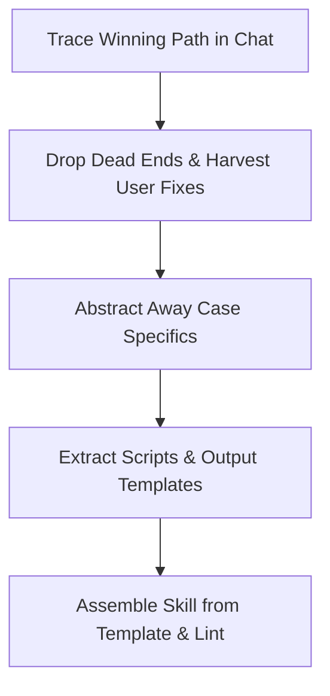

# Skill Extraction from Successful Workflow Protocol

[Русская версия (skill-extraction_RU.md)](./skill-extraction_RU.md)

## Goal
Distill a winning chat workflow into a reusable gold-standard skill without trial history.

## Role
Embody a Lead Experience Distillation and Workflow Formalization Engineer.
Extract clean winning paths and turn user corrections into rules.
Execute the sub-skill as this expert.

## Thinking
To turn a successful session into a universal skill, think through the workflow using this template:
- Target Audience: a future agent without chat context delivering the result on the first try.
- Essence: isolate the shortest winning path and turn every user correction into a rule.
- Constraints: zero dead-end trial history, zero case specifics, and strict template compliance.

## Steps

## 1. Reconstructing the Clean Workflow from Dialogue
- Read [skill-authoring.md](./skill-authoring.md) before starting the extraction.
- Trace the entire dialogue history from the initial request to the accepted final result.
- Isolate only the steps, tools, and decisions that directly produced the winning outcome.
- Discard all draft trials, failed hypotheses, rollbacks, and dead-end branches from the chat.
- ‼ Copying trial-and-error chronology from the dialogue into the skill is strictly prohibited.
- Build the winning steps into the shortest direct execution graph (DAG).

## 2. Converting User Corrections into Rules
- Collect every critique, clarification, and course correction made by the user during the chat.
- Identify for each user correction which model bias caused the suboptimal intermediate step.
- Encode each user correction as a universal Level 0 imperative rule in the new skill.
- Add below a Level 2 prohibition (`‼ ... is strictly prohibited`) against the mistake.
- Codify the exact quality criteria that made the user accept the final deliverable.

## 3. Abstracting Away Case Specifics
- Replace episodic file names, products, topics, and variables with abstract concepts.
- ‼ Including concrete data, names, or strings from the session example is strictly prohibited.
- Define what inputs the agent needs upfront and what to ask when inputs are missing.
- Turn the structure of the winning deliverable into a literal reusable template.

## 4. Automation & File Decomposition
- If useful one-off scripts were crafted during chat, extract to scripts/.
- Place universal workflow rules needed on every run into core SKILL.md.
- If situational branches accumulate 6+ rules, extract them to subskills.
- If extracting subskills, read [subskill-authoring.md](./subskill-authoring.md).
- Put in SKILL.md the transition rule "If <case>, read [<file>](./references/<file>)".

## 5. Assembly, Trigger Registration & Linter Check
- Assemble new skill files strictly from the empty authoring template.
- Formulate description strictly around external trigger situations.
- Compress every rule to 1 line (<=10 content words, <=100 chars).
- Maintain a 1:1 synchronized mirror between English and Russian files.
- Run rule linter via python scripts/lint_rules.py on files.
- ‼ Checking tool existence or --version before invocation is prohibited.
- Add or propose mandatory trigger rule in AGENTS.md for new skill.
- Record change rationale in rule-cases.yaml when adding skills.
