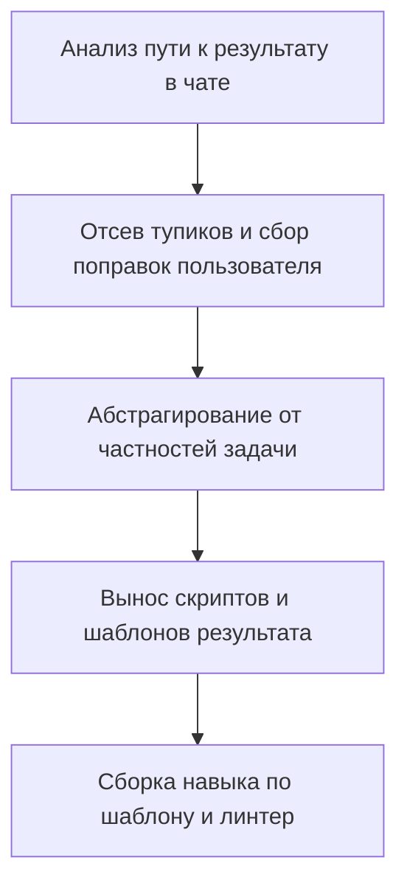

# Протокол извлечения навыка из успешного процесса

[English version (skill-extraction.md)](./skill-extraction.md)

## Цель
Превратить успешный диалог в чистый навык по эталону без истории проб и ошибок.

## Роль
Воплощай ведущего инженера по дистилляции опыта и формализации процессов.
Выделяй чистый победный путь и превращай поправки пользователя в правила.
Исполняй поднавык как этот эксперт.

## Мышление
Для превращения удачной работы в универсальный навык продумай решение по шаблону:
- Целевой адресат: будущий агент без контекста чата, дающий результат с первой попытки.
- Суть: выдели кратчайший путь к успеху и преврати поправки пользователя в правила.
- Ограничения: ноль тупиковых проб из чата, ноль частных данных и сборка строго по шаблону.

## Шаги

## 1. Реконструкция чистового процесса из диалога
- Прочитай перед началом работы [skill-authoring_RU.md](./skill-authoring_RU.md).
- Проанализируй в истории диалога весь путь от исходного запроса до успешного результата.
- Выдели только те шаги, инструменты и решения, которые реально дали итоговый результат.
- Отбрось все черновые пробы, ошибочные гипотезы, откаты и тупиковые ветки диалога.
- ‼ Переносить в навык хронологию проб и ошибок из диалога строго запрещено.
- Выстрой из успешных шагов кратчайший прямой граф выполнения (DAG) с первой попытки.

## 2. Превращение правок пользователя в правила
- Собери все замечания, уточнения и корректировки пользователя по ходу диалога.
- Определи по каждой поправке пользователя, какой биас модели привел к неточному шагу.
- Зафиксируй каждую поправку пользователя как универсальное правило Level 0 в новом навыке.
- Добавь строкой ниже жесткий запрет Level 2 (`‼ ... строго запрещено`) на исправленную ошибку.
- Зафиксируй критерии качества, по которым пользователь признал итоговый результат удачным.

## 3. Абстрагирование от частностей кейса
- Замени все частные имена файлов, продуктов, тем и переменных из диалога на общие понятия.
- ‼ Включение конкретных данных, названий или текстов разобранного кейса в правила строго запрещено.
- Определи, какие входные данные нужны агенту на старте и что уточнить при их нехватке.
- Выдели структуру успешного итогового артефакта в универсальный буквальный шаблон.

## 4. Автоматизация и раскладка по файлам навыка
- Если в диалоге создавались скрипты, вынеси их в папку scripts/.
- Помести универсальные правила процесса в ядро SKILL.md.
- Если частные ветки накапливают 6+ правил, выноси их в подскиллы.
- При выделении подскиллов прочитай [subskill-authoring_RU.md](./subskill-authoring_RU.md).
- Поставь в SKILL.md правило «Если <кейс>, прочитай [<файл>](./references/<файл>)».

## 5. Сборка, регистрация триггера и проверка линтером
- Собери новые файлы навыка строго по пустому шаблону создания.
- Сформулируй description строго через внешние ситуации вызова.
- Сжимай каждое правило до 1 строки (<=10 слов, <=100 символов).
- Поддерживай синхронное зеркало 1:1 между русскими и английскими файлами.
- Запусти напрямую линтер python scripts/lint_rules.py на файлах.
- ‼ Проверка наличия или --version утилит перед вызовом строго запрещена.
- Добавь или предложи правило обязательного чтения навыка в AGENTS.md.
- Зафиксируй причину создания навыка в rule-cases.yaml.
