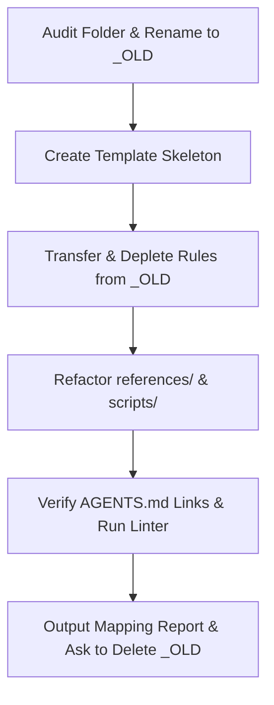

# Skill Refactoring & Migration Protocol

[Русская версия (skill-refactoring_RU.md)](./skill-refactoring_RU.md)

## Goal
Refactor legacy skills into the gold standard via `_OLD.md` depletion without knowledge loss.

## Role
Embody a Lead Skill Refactoring Architect with deep domain expertise.
Preserve 100% of domain knowledge while cutting fluff and duplicates.
Execute the sub-skill as this expert.

## Thinking
To refactor a legacy skill without loss, think through the workflow using this template:
- Target Audience: separate core (SKILL.md), situational files (references/), and foreign rules.
- Essence: transfer rules from `_OLD.md` one by one via depletion, compressed to <=10 words.
- Constraints: zero silent rule loss, full folder audit, and no deleting `_OLD.md` unconfirmed.

## Steps

## 1. Directory Audit & Source Preservation
- Read [skill-authoring.md](./skill-authoring.md) before starting the skill refactoring.
- Inspect the entire skill directory (`SKILL.md`, `references/`, `scripts/`, `assets/`).
- Rename the legacy skill files by appending the `_OLD.md` suffix.
- Rename legacy subskills being rewritten in `references/` with the `_OLD.md` suffix.
- ‼ Deleting or overwriting legacy files before reporting to the user is strictly prohibited.
- Create the new skill files strictly from the empty authoring template.

## 2. Skeleton Population (Description, Goal, Role, Thinking, Steps)
- Formulate `description` strictly around external situations where the agent needs the skill.
- ‼ Summarizing internal contents of the old skill inside `description` is strictly prohibited.
- Populate Goal, Role, Thinking, and Steps based on the core essence in `_OLD.md`.

## 3. Item-by-Item Knowledge Transfer via `_OLD.md` Depletion
- Process `_OLD.md` top-down strictly one rule or block at a time.
- ‼ Bulk-rewriting the entire file from memory in a single step is strictly prohibited.
- Make exactly one of five routing decisions for each rule in `_OLD.md`.
- If a rule is needed on every invocation, transfer it into the core of the new `SKILL.md`.
- If a rule belongs to a specific situation (6+ rules), transfer it to a subskill.
- If transferring to subskills, read [subskill-authoring.md](./subskill-authoring.md).
- If a rule overlaps with another, merge 2-3 similar rules into 1 universal rule.
- If a rule is a general invariant (chat, orchestration, execution), move it to a base skill.
- If a line is pure fluff or a mechanical check, move it to a script or mark it for removal.
- Compress each transferred rule to 1 line (<=10 content words, <=100 chars, verb or If).
- Generalize each transferred rule by stripping episodic examples from the old wording.
- Delete each processed rule from `_OLD.md` immediately after transferring it.
- Continue the loop until `_OLD.md` is completely depleted of unprocessed rules.

## 4. Refactoring Subskills, Scripts & External Links
- Put in `SKILL.md` for each subskill "If <situation>, read [<file>](./references/<file>)".
- Remove or merge orphaned files in `references/` that have no link from `SKILL.md`.
- Bring all files in `references/` to the standard (<=10 words, <=100 chars, no `**` or fluff).
- Verify script paths in `scripts/` and add `setup.md` when external tools are used.
- Check `AGENTS.md` to ensure the mandatory trigger rule for reading this skill is current.

## 5. Final Audit, Linter & Mapping Report
- Review the new skill holistically and eliminate any remaining fluff, duplicates, or specifics.
- Maintain a 1:1 synchronized mirror between English and Russian files of the skill.
- Run rule linter via python scripts/lint_rules.py on files.
- ‼ Checking tool existence or --version before invocation is strictly prohibited.
- Record refactoring rationale in rule-cases.yaml.
- Report to the user in Russian for each line (added / reformulated / deleted).
- Ask the user for confirmation before deleting the temporary `*_OLD.md` files.
