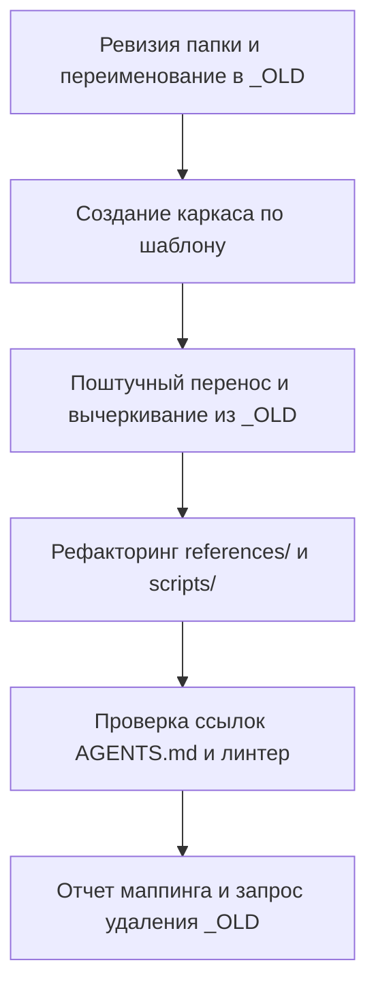

# Протокол рефакторинга и миграции навыка

[English version (skill-refactoring.md)](./skill-refactoring.md)

## Цель
Переложить старый навык в эталонный формат без потери знаний через истощение `_OLD.md`.

## Роль
Воплощай ведущего архитектора рефакторинга навыков ИИ-агентов.
Сохраняй 100% доменных знаний, отсекая воду, повторы и частности.
Исполняй поднавык как этот эксперт.

## Мышление
Для безошибочного рефакторинга старого навыка продумай работу по шаблону:
- Целевой адресат: отдели ядро (SKILL.md), ситуационные файлы (references/) и чужие правила.
- Суть: перенеси правила из `_OLD.md` поштучно методом вычеркивания со сжатием до <=10 слов.
- Ограничения: ноль тихих потерь правил, ревизия всех папок и запрет удаления `_OLD.md` без спроса.

## Шаги

## 1. Ревизия папки и сохранение исходников
- Прочитай перед началом рефакторинга [skill-authoring_RU.md](./skill-authoring_RU.md).
- Проверь все содержимое папки навыка (`SKILL.md`, `references/`, `scripts/`, `assets/`).
- Переименуй старые файлы навыка с добавлением суффикса `_OLD.md`.
- Переименуй переписываемые подскиллы в `references/` с суффиксом `_OLD.md`.
- ‼ Удаление или затирание старых файлов до отчета пользователю строго запрещено.
- Создай новые файлы навыка строго по пустому шаблону создания навыков.

## 2. Заполнение каркаса (Description, Цель, Роль, Мышление, Шаги)
- Сформулируй `description` строго через внешние ситуации, когда агенту нужен этот навык.
- ‼ Пересказывать внутреннее содержимое старого навыка в `description` строго запрещено.
- Заполни разделы «Цель», «Роль», «Мышление» и «Шаги» по сути знаний из `_OLD.md`.

## 3. Поштучный перенос знаний методом опустошения `_OLD.md`
- Разбирай `_OLD.md` сверху вниз строго по одному правилу или блоку за шаг.
- ‼ Пакетный перенос всего файла «по памяти» за один шаг строго запрещен.
- Принимай по каждому правилу из `_OLD.md` ровно одно из пяти решений:
- Если правило нужно при каждом вызове навыка, перенеси его в ядро нового `SKILL.md`.
- Если правило относится к частной ситуации (6+ правил), перенеси его в подскилл.
- При переносе в подскилл прочитай [subskill-authoring_RU.md](./subskill-authoring_RU.md).
- Если правило дублирует соседнее, объедини 2-3 схожих правила в 1 универсальное.
- Если правило общее для всех задач (общение, оркестрация, исполнение), вынеси в базовый навык.
- Если строка является водой или механической проверкой, вынеси в скрипт или пометь к удалению.
- Сжимай каждое правило до 1 строки (<=10 слов, <=100 символов, с глагола или «Если»).
- Обобщай каждое переносимое правило, убирая частности и примеры из старой формулировки.
- Удаляй обработанное правило из `_OLD.md` сразу после его переноса в новый файл.
- Продолжай цикл, пока `_OLD.md` не опустеет до нуля необработанных правил.

## 4. Рефакторинг подскиллов, скриптов и внешних связей
- Ставь на каждый подскилл правило «Если <ситуация>, прочитай [<файл>](./references/<файл>)».
- Удали или объедини осиротевшие файлы в `references/`, на которые нет ссылок из `SKILL.md`.
- Приведи все файлы в `references/` к стандарту (<=10 слов, <=100 символов, без `**` и воды).
- Проверь пути к скриптам в `scripts/` и наличие `setup.md` при внешних утилитах.
- Проверь в `AGENTS.md` актуальность правила обязательного чтения этого навыка.

## 5. Финальная сверка, линтер и отчет маппинга
- Посмотри на новый навык целиком и устрани оставшуюся воду, повторы и частности.
- Поддерживай синхронное зеркало 1:1 между английскими и русскими файлами навыка.
- Запусти напрямую линтер python scripts/lint_rules.py на файлах.
- ‼ Проверка наличия или --version утилит перед вызовом строго запрещена.
- Зафиксируй причину рефакторинга в rule-cases.yaml.
- Доложи пользователю на русском по каждой строке (добавлено / переформулировано / удалено).
- Запроси у пользователя подтверждение на удаление временных файлов `*_OLD.md`.
